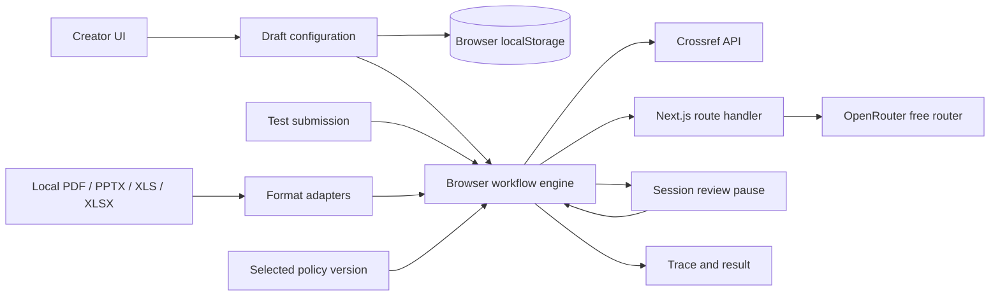

# Architecture

## Runtime boundaries

Next.js App Router serves the application. `app/studio-client.jsx` loads the existing studio as a client-only boundary because workflow state, localStorage, file inputs and PDF.js are browser-owned. The workflow engine still runs in the browser. Node route handlers expose only the AI status and assistance endpoints; Crossref is called directly from the browser.

## Source map

| Area | Files | Responsibility |
|---|---|---|
| App entry | `app/layout.jsx`, `app/page.jsx`, `app/studio-client.jsx`, `app/globals.css` | App Router shell, metadata, client boundary, global styles |
| Shell and forms | `src/main.jsx`, `src/style.css` | Navigation, inputs, preview, sidebar |
| Draft lifecycle | `src/useDraft.js`, `src/draftStorage.js` | Autosave, recovery, reset |
| Workflow UI | `src/WorkflowStudio.jsx`, `src/TreeBuilder.jsx`, `src/treeModel.js` | Canvas, edits, test orchestration |
| Settings | `src/BlockSettings.jsx`, `src/NodeSettings.jsx` | Generic blocks and tool configuration |
| Definitions | `src/workflowModel.js` | Ports, defaults, mappings, publication example |
| Execution | `src/workflowEngine.js` | Validation, handlers, traversal, reviews |
| Evidence adapters | `src/documentReader.js`, `src/pdfReader.js` | Local PDF, presentation and spreadsheet extraction |
| Results | `src/WorkflowTest.jsx`, `src/ResultSummary.jsx` | Submission form, trace, decision forms |
| Scoring | `src/ScoringStudio.jsx`, `src/scoringPolicy.js` | Standalone rules and saved versions |
| Documents | `src/pdfReader.js`, `src/paperFindings.js`, `scripts/copy-pdf-worker.mjs` | PDF text, candidates, browser-worker preparation |
| AI | `src/aiContext.js`, `server/ai.js`, `server/nextAiRoute.js`, `app/api/ai-*` | Bounds, provider calls, Next.js endpoints |

`src/WorkflowView.jsx` and `src/ExtractionPanel.jsx` are older retained implementations. The active main app imports `WorkflowStudio.jsx` under the local name `WorkflowView`; the similarly named old file is not the active entry point.

## State ownership

`useDraft` owns persisted name, fields, nodes, and standalone policy. App state separately owns submission values. `WorkflowStudio` owns runs, review history, and approved duplicate records. Refs prevent overlapping local actions and detect stale reviews after configuration/submission changes.

Canvas selection, zoom, library visibility, and undo are transient. Sidebar collapse has a separate preference key. Clear saved draft removes KPI storage and reloads, resetting session state while retaining sidebar preference.

Draft writes carry a revision and a per-tab writer identity. A tab that sees a higher revision from another writer stops saving and offers reload or keep-my-version, so two tabs do not silently overwrite each other. Import validates a downloaded draft or workflow export and replaces the current draft only after confirmation. These protections are browser-local; there is no server-side lock or merge.

## Graph and scoring design

Nodes and route IDs form a directed acyclic graph. The visual hierarchy can share a later node across paths. Layout derives from connections; execution follows one selected route at a time, not every visible branch.

The new Publication workflow omits simulated indexing and AI. Its Clear branch runs the generic saved-policy action; Needs review and Ineligible bypass scoring, and all three paths converge on the same specialized Appraiser review node. Older 12-step publication graphs retain their index/scoring/AI handlers for saved-draft compatibility. Generic Actions reuse tool handlers without forcing every KPI into the publication example. Product creation is ordered Inputs → Scoring policy → Workflow: organizations define reusable scoring rules/components and connect them to workflow evidence. Formula policies support arbitrary component counts and generic aggregation; they do not encode a particular document count or KPI. Legacy Read/External lookup/PDF-only/review-branch steps remain loadable for saved-draft compatibility but are hidden from the new experience.

## Reusable tool layer

`reusableTools.js` defines generic tool ports, defaults, validation and execution. `ReusableSettings.jsx` exposes creator configuration. `PluginPicker.jsx` presents the built-in Publication workflow and can add the complete 10-step verification and scoring flow at once; `publicationWorkflow(fields, policy)` wraps publication operations while preserving Submit and the generic Apply scoring policy Action. The active saved version is preselected when available. Clear routes through scoring; Needs review and Ineligible go directly to shared Appraiser review. The former simulated-index and AI steps remain readable in old graphs but are not offered by the new plugin. Replacing a populated graph requires explicit confirmation, and the canvas Undo restores the prior graph. Plugin wrappers retain operation IDs and contracts. No third-party package execution or runtime plugin installation is introduced.

Evidence sections carry PDF page, PPTX slide, or spreadsheet sheet/range locations. AI combines a primary input, named mapped contexts, creator rubric and optional output schema before the shared input-bound checks; provider calls are blocked when those checks indicate truncation. Parsed numeric schema fields can feed formula policy components. Generic Human review assembles the complete executed package and terminates automation for transfer to the separate review module; it does not create decision branches.

## Planned Prediction Framework boundary

Prediction is not implemented in the current PoC. The planned [Prediction Framework](PREDICTION-FRAMEWORK-IMPLEMENTATION-PLAN.md) consumes versioned, verified progress snapshots and predicts only the final overall score in its first iteration. It remains downstream of Framework Studio and deterministic scoring and cannot mutate evidence, policy calculations, reviews, or the official score.

The planned architecture separates model preparation from live inference. Completed cycles and checkpoint snapshots feed readiness, training, time-based evaluation, approval, and an organization-scoped model registry. Dashboard access uses the current verified snapshot with either a rule-based estimate, an approved limited-data model, or an approved organization model. It does not retrain a model during login or dashboard access.
