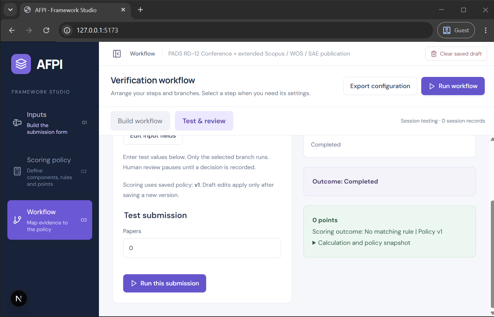

# PADS individual KPI verification (59 rows)

Committed reference fixtures and automated scoring evidence for 59 of the 64 individual KPI rows in the PADS 2021 template. Related: [PADS TL-1 walkthrough](PADS-TL1-WALKTHROUGH.md), [Testing and acceptance](TESTING.md), [Scoring](SCORING.md).

## Scope

- 59 of 64 individual KPI rows: 14 Teaching & Learning, 16 Research & Development, 11 External Interface, 10 Operations, 6 Student Development, 2 Extra & Co-Curricular.
- 201 deterministic scoring cases, one set per row, executed through the workflow engine by `src/padsAllKpis.test.js`.
- Individual-KPI provisional scoring only. This is **not** a complete PADS appraisal: no KRA weights, role maxima, 200-point cap, mandatory-eligibility gate, dual self/supervisor scores, overall review, or aggregation (see [Limits](#limits)).
- The five institutional rows are deliberately absent; see [Institutional rows](#institutional-rows).
- These fixtures are a working interpretation of the template, not an institutional approval.

## Source and method

| Item | Value |
| --- | --- |
| Workbook | `public/samples/PADS.xlsx`, SHA-256 `a44c39681c0da5e2a544305dbe477901e60d5cc56b62b199aa1592f6912b0c15` |
| Sheet | `PADS Template` |
| Columns used | A `KRA :` section headers, B `Sl No`, C `KPI`, D `Criteria`/`Detail`, E `Max Points` |
| Fixtures | `public/samples/pads/kpis/<id>.json` — 59 saved-draft records (`{version, savedAt, draft}`) |
| Cases | `public/samples/pads/kpis/cases.json` — 59 groups, 201 cases (`values` + `expect`) |
| Source map | `public/samples/pads/kpis/index.json` — workbook row, Sl No, fields, case count, expected points per id |
| Test | `npm test` → `src/padsAllKpis.test.js` |

KPI ids are derived from the workbook section: `<kra prefix>-<Sl No>` with prefixes `tl`, `rd`, `ei`, `o`, `sd`, `ec`. Every numeric `Sl No` row with a KPI name inside those six sections maps to exactly one committed id; `index.json` records the workbook row so the mapping is auditable without re-parsing the spreadsheet.

Each fixture is a complete saved draft with `draft.policy.enabled === true`: Inputs → Scoring policy (conditional rules, `v1`, sum aggregation, zero fallback) → Workflow (Submit → Result). The test feeds each case's `values` into `runWorkflow` with `extract: null` and asserts `status === "completed"`, `scoring.status === "scored"`, and `scoring.points === expect`. It also asserts the fixture's ordered `{id, type}` field list matches the case group, so a renamed or retyped field cannot silently pass.

All 201 cases scored as expected at 201/201. No assertion accepts `pending`, `invalid`, or error states.

## Row map

Workbook rows refer to `PADS Template` in `public/samples/PADS.xlsx`. `Fields` lists the input field ids in `cases.json` order. `Expected points` is the sorted unique set of asserted outcomes.

| KPI ID | Workbook row | KPI | Fields | Cases | Expected points |
| --- | --- | --- | --- | --- | --- |
| `tl-1` | 13 | TL-1 Teaching Pedagogy & Content Preparation | pct | 4 | 0, 4, 6, 8 |
| `tl-2` | 16 | TL-2 Use of Technology / Class notes | pct | 4 | 0, 4, 6, 8 |
| `tl-3` | 20 | TL-3 HOD Feedback | pct | 4 | 0, 4, 6, 8 |
| `tl-4` | 23 | TL-4 Student Feedback | pct | 4 | 0, 4, 6, 8 |
| `tl-5` | 27 | TL-5 Activities for uplifting slow learners | count | 4 | 0, 4, 8 |
| `tl-6` | 28 | TL-6 Course result outcome aggregate (2 and 1 credit) | pct | 5 | 0, 2, 4, 6 |
| `tl-7` | 31 | TL-7 Course result outcome aggregate (4 credit analytical) | pct | 5 | 0, 6, 8, 10 |
| `tl-8` | 34 | TL-8 Course result outcome aggregate (3 credit non-analytical) | pct | 4 | 0, 4, 6, 8 |
| `tl-9` | 38 | TL-9 Student course attendance | pct | 5 | 0, 2, 3, 4 |
| `tl-10` | 41 | TL-10 Conducting professional courses and training | count | 4 | 0, 5, 10 |
| `tl-11` | 43 | TL-11 Faculty Development Certification | kind | 3 | 0, 4, 24 |
| `tl-12` | 48 | TL-12 PhD Status | status | 3 | 0, 8, 14 |
| `tl-13` | 53 | TL-13 NET / SET Qualified | status | 3 | 0, 4, 8 |
| `tl-14` | 55 | TL-14 Training Program hours per year | hours | 5 | 0, 2, 4, 6 |
| `rd-1` | 64 | RD-1 Paper publication Scopus / WOS / SAE | role, indexed | 4 | 0, 6, 12, 24 |
| `rd-2` | 66 | RD-2 Paper publication others (UGC/ICI) | role, count | 3 | 0, 3, 18 |
| `rd-3` | 67 | RD-3 Book or chapter publishing (ISBN) | role, kind | 3 | 0, 10, 25 |
| `rd-4` | 70 | RD-4 Conference paper outside India | count | 3 | 0, 10 |
| `rd-5` | 72 | RD-5 Guiding student Scopus / WOS publication | count | 3 | 0, 5 |
| `rd-6` | 74 | RD-6 Funded project submission | submitted, presented | 4 | 0, 12, 22, 24 |
| `rd-7` | 75 | RD-7 Externally funded project | amount | 4 | 0, 4, 10, 24 |
| `rd-8` | 80 | RD-8 Patent | status | 3 | 0, 8, 24 |
| `rd-9` | 85 | RD-9 Increase in h index | value | 4 | 0, 3, 6 |
| `rd-10` | 87 | RD-10 Increase in citations | value | 4 | 0, 3, 6 |
| `rd-11` | 89 | RD-11 Conference presentation at IIT / IISC / NIT | count | 3 | 0, 5 |
| `rd-12` | 90 | RD-12 Conference + extended Scopus / WOS / SAE publication | count | 3 | 0, 30 |
| `rd-13` | 92 | RD-13 Product development (commercial) | status | 3 | 0, 4, 16 |
| `rd-14` | 96 | RD-14 Product development from student projects | status | 3 | 0, 1, 10 |
| `rd-15` | 99 | RD-15 Facilitation of student involvement in RIG | students | 3 | 0, 7, 14 |
| `rd-16` | 100 | RD-16 Facilitation of student involvement in Forge | students | 3 | 0, 7, 14 |
| `ei-1` | 107 | EI-1 Industrial / Research consultancy (financial) | amount | 4 | 0, 8, 16, 24 |
| `ei-2` | 110 | EI-2 FDP participation (7+ days) | count | 3 | 0, 12, 24 |
| `ei-3` | 112 | EI-3 MOU signed | count | 3 | 0, 10, 20 |
| `ei-4` | 114 | EI-4 Consultancy (institutional branding) | count | 3 | 0, 2, 4 |
| `ei-5` | 115 | EI-5 Sabbatical program | count | 3 | 0, 8 |
| `ei-6` | 116 | EI-6 International award | count | 3 | 0, 6, 12 |
| `ei-7` | 117 | EI-7 National / State award | count | 3 | 0, 3, 6 |
| `ei-8` | 118 | EI-8 Editorial board member (Scopus/WOS) | count | 3 | 0, 14 |
| `ei-9` | 119 | EI-9 Reviewer (Scopus/WOS) | count | 3 | 0, 9 |
| `ei-10` | 120 | EI-10 Editor or reviewer (other journal) | count | 3 | 0, 5 |
| `ei-11` | 122 | EI-11 NGO collaboration | count | 3 | 0, 5, 10 |
| `o-1` | 129 | O-1 Heading independent body | count | 3 | 0, 15, 30 |
| `o-2` | 130 | O-2 Ranking / accreditation responsibility | role, count | 3 | 0, 3, 30 |
| `o-3` | 131 | O-3 Organizing conference | role, attendees | 4 | 0, 4, 5, 10 |
| `o-4` | 134 | O-4 Organizing AICTE / sponsored FDP | role, funding | 4 | 0, 5, 10 |
| `o-5` | 137 | O-5 Organizing workshop / seminar | role, attendees | 3 | 0, 5, 10 |
| `o-6` | 140 | O-6 Alumni entrepreneur projects | count | 3 | 0, 10, 20 |
| `o-7` | 141 | O-7 Outreach program expert | attendees | 3 | 0, 4, 10 |
| `o-8` | 144 | O-8 Professional external audit member | count | 3 | 0, 14, 28 |
| `o-9` | 146 | O-9 Blogs on education | count | 3 | 0, 3, 6 |
| `o-10` | 147 | O-10 External expert / guest lecture | role | 4 | 0, 7.5, 8.5, 9 |
| `sd-1` | 154 | SD-1 Organizing local visits | count | 3 | 0, 3, 6 |
| `sd-2` | 155 | SD-2 Placing student in core industry | count | 3 | 0, 8, 24 |
| `sd-3` | 156 | SD-3 Referred internship | count | 3 | 0, 4, 12 |
| `sd-4` | 157 | SD-4 Student research development | count | 3 | 0, 3, 6 |
| `sd-5` | 158 | SD-5 Student mentoring | count | 3 | 0, 4, 8 |
| `sd-6` | 159 | SD-6 Leadership and skill development | count | 3 | 0, 3, 6 |
| `ec-1` | 166 | EC-1 Student accomplishments (co-curricular) | students | 3 | 0, 5, 10 |
| `ec-2` | 167 | EC-2 Student accomplishments (extra-curricular) | students | 3 | 0, 4, 8 |

## Institutional rows

Workbook rows **173–177** under `KRA : INSTITUTIONAL OR DEPARTMENTAL CONTRIBUTIONS AND OUTCOMES` — BOS coordinator/Placement Coordinator, NAAC criteria I Coordinator, MS Team Coordinator, Spoken Tutorial Coordinator, Class Advisor — are intentionally **not** implemented.

> PADS scores these duties on a 5-point supervisor scale and provides no Max Points, evidence fields, role eligibility, caps, or aggregation rules. AFPI would need a 1-5 institutional score field, duty/role eligibility, evidence or notes, supervisor or panel review, one claim per duty per period, audit history, and aggregation into the institutional KRA.

The same text is recorded in `public/samples/pads/kpis/index.json` (`excluded.reason`), `public/samples/pads/kpis/README.md`, and the header comment of `src/padsAllKpis.test.js`. No test asserts a score for these five rows.

## Limits

Not implemented or not exercised here:

- PADS KRA weights and totals, role-specific maxima (Assistant/Associate Professor, Professor, HOD), and the 200-point cap.
- Mandatory assessment eligibility (Scopus/Annexure-I paper or 7-day FDP), separate self and supervisor scores, descriptive assessment, overall feedback, HR observations, and panel review of institutional contributions.
- The five institutional rows above, and any aggregation across KPIs or KRAs.

Encoding simplifications carried by these fixtures (all recorded in [Testing](TESTING.md)):

- Author role is Primary/Co-author only; the Guidelines' third-author 25% share is absent.
- TL-11 scores one course rather than multiple courses; TL-12 does not model its additive PhD/guideship/guiding components.
- Role/eligibility wording has no validating field: "primary coordinator" (EI-1, EI-3, EI-4, EI-11, SD-1, SD-4, SD-6, EC-1, EC-2), RD-5's co-author requirement, RD-12's combined conference-plus-publication condition, O-4's minimum 40 external attendees.
- Multi-event caps are unreachable: O-2 awards 3 points for any committee membership rather than 3 per member up to two; O-3, O-5, O-7 and O-10 score a single event/visit.
- RD-6 is encoded as enumerated submitted/presented combinations rather than an additive formula.
- Negative numbers pass field validation and fall through the zero fallback (observed with `-5`); values above the workbook maximum were not exercised.

Because all 59 rows are form-value policies, PDF evidence extraction, extraction comparison, and network lookups are not part of this evidence (`extract: null`). Every case is deterministic and offline.

## Evidence

- Fixtures, cases and source map: [`public/samples/pads/kpis/`](../public/samples/pads/kpis/), [`cases.json`](../public/samples/pads/kpis/cases.json), [`index.json`](../public/samples/pads/kpis/index.json).
- Automated suite: `src/padsAllKpis.test.js` — 60 tests (1 metadata test, 59 KPI tests) over 201 cases.
- Command: `npm test` → focused file 60/60 passing; full suite 167/167 passing on 30 October 2026.
- Prior UI check for the RD-12 zero case: . Captured during the 29 October 2026 UI pass, not re-run for this document; the 201 automated cases above are the complete verification artifact.
