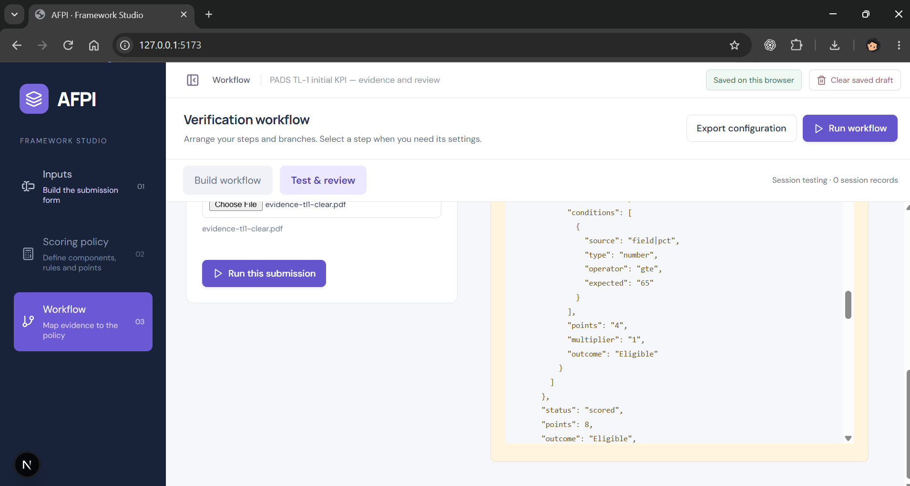
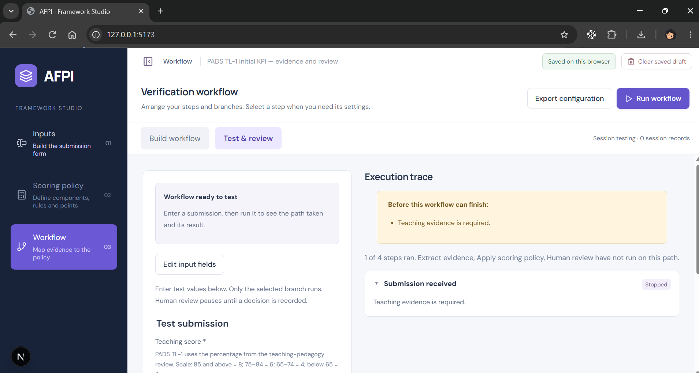
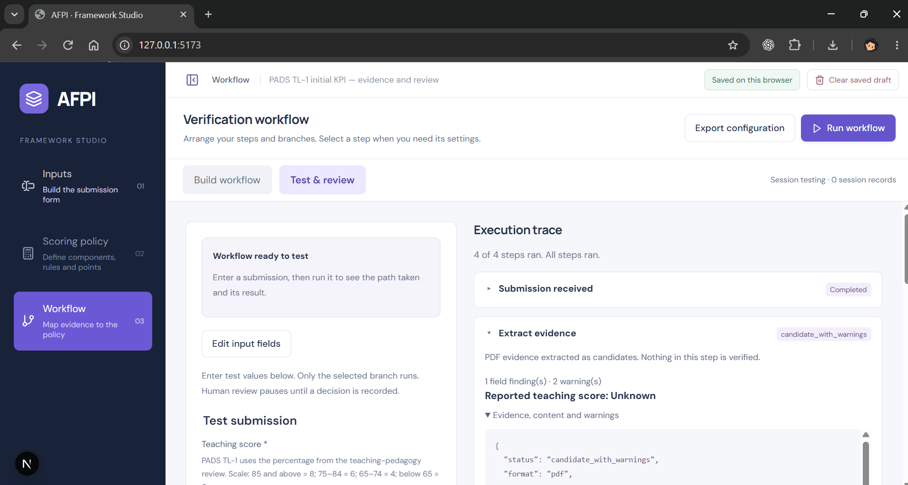

# PADS TL-1 initial-KPI verification

Status: **review-ready local verification**, not an institutional approval. This walkthrough covers one KPI row, `TL-1`, and the local Framework Studio paths in [issue #9](https://github.com/Kaushiik-13/KCT_AppraisalPortal/issues/9). It does not implement the full PADS appraisal or the other 58 KPI rows; [PADS individual KPI verification](PADS-INDIVIDUAL-KPIS.md) covers all 59 individual rows with committed fixtures and 201 automated cases.

## Workbook source and scope

| Item | Value |
|---|---|
| Workbook | `public/samples/PADS.xlsx` |
| Version | PADS Academic Review - 2021 (Kumaraguru College of Technology) |
| Source | Supplied by the project owner on 29 October 2026; unmodified copy |
| SHA-256 | `a44c39681c0da5e2a544305dbe477901e60d5cc56b62b199aa1592f6912b0c15` |
| Approval status | **Reference/teaching template only**. Live institutional approval is not verified; confirm the approved source before treating scores as authoritative. See [sample notes](../public/samples/README.txt). |
| Sheet | `PADS Template` |
| KRA section | Row 10, `KRA : TEACHING AND LEARNING` |
| Header row | Row 11 |
| TL-1 row | Row 13; criteria and Max Points continue through rows 14–15 |
| Columns used | `A` KRA code (`TL`), `B` Sl No (`1`), `C` KPI, `D` Criteria, `E` Max Points |
| Columns deliberately not used | `F` Self Score, `G` Supervisor Score, and the descriptive-assessment columns. No appraisee, employee, or appraiser data is read or stored. |

## KPI definition

Workbook text:

- **KRA:** Teaching and Learning (`TL`)
- **KPI:** Teaching Pedagogy & Content Preparation (`Sl No 1`)
- **Criteria:** `> 85 %`; `84 - 75 %`; `74 - 65 %`
- **Max Points:** 8

Deterministic expectation used by the fixture:

| Percentage | Expected points | Workbook basis |
|---:|---:|---|
| 85–100 | 8 | `> 85 %`, interpreted as 85 and above (see boundary note) |
| 75–84 | 6 | `84 - 75 %` |
| 65–74 | 4 | `74 - 65 %` |
| below 65 | 0 | No matching row; policy zero fallback |

Boundary note: the workbook says `> 85 %`, which strictly excludes 85, while the next band `84 - 75 %` also excludes 85. The fixture uses `>= 85` so integer score 85 receives 8 points. This is a mapping decision, not an approved institutional interpretation; confirm it with the owner. The fixture also uses `>= 75` and `>= 65` for the lower bands. The fixture's help text and policy names match these tested boundaries.

Eligibility, mandatory rules, and role caps: the TL-1 row contains no eligibility gate, mandatory-evidence rule, or role-specific maximum. Those checks are **not applicable** to this KPI. KRA totals, role maxima, the 200-point cap, and the five institutional-contribution rows are outside this test.

## Configuration and evidence

Committed, synthetic verification artifacts:

| Artifact | Purpose |
|---|---|
| `public/samples/pads/tl1-initial-kpi.json` | Saved-draft record for localStorage; Inputs → Scoring policy → Workflow → Test & review |
| `public/samples/pads/evidence-tl1-clear.pdf` | One-page synthetic PDF containing `Teaching score: 90` |
| `public/samples/pads/evidence-tl1-unreadable.pdf` | One-page synthetic PDF with no extractable text |
| `public/samples/pads/evidence-tl1-invalid.txt` | Deliberately unsupported file format |
| `src/padsInitialKpi.test.js` | Deterministic engine coverage for bands, validation, extraction uncertainty, and review handoff |
| `docs/assets/pads-tl1/*.png` | Browser screenshots listed below |

No real personal data or institutional submission is included. The evidence files and draft are test fixtures, not PADS source documents.

Configured workflow:

1. **Submission received** — form fields `Teaching score` (required number) and `Teaching evidence` (required PDF/PPTX/XLS/XLSX).
2. **Extract evidence** — labelled extraction of `Teaching score` into `reported_score`; candidates remain unverified.
3. **Apply scoring policy** — saved `v1` rules policy with the three bands above and zero fallback.
4. **Human review** — terminal handoff to role `Appraiser` with the full package. No approve/reject or clarification branches.

The extraction label is a test convention: the synthetic PDF spells the line exactly `Teaching score: 90`. PADS does not prescribe this label.

## Expected versus actual

| Path | Input | Expected | Actual |
|---|---|---|---|
| Clear | `90` + clear PDF | 8 points; extraction candidate; sent to review | **8 points**, `Eligible`, extraction `candidate`, review status `sent-to-review` |
| Band boundaries | `85`, `84`, `75`, `74`, `65`, `64` | `8, 6, 6, 4, 4, 0` | All matched in the automated run |
| Missing score | blank score | Required-field error; no run | Required-field error |
| Missing evidence | `90` + no file | Required-field error; extraction not called | Required-field error; extractor call count 0 |
| Invalid score | non-numeric text | “Enter a valid number.” | Matched |
| Invalid file | `.txt` upload | “Teaching evidence: select the allowed file format and count.” | Matched in UI; automated validation also rejects it |
| Uncertain/unreadable | `90` + blank PDF | Explicit unknown extraction; provisional 8; sent to review | `candidate_with_warnings`, reported score **Unknown**, 2 warnings, provisional **8**, `sent-to-review` |
| Role cap / mandatory rule | — | Not applicable to TL-1 | No role cap or mandatory gate exists in this KPI |
| Human review | Clear or uncertain run | Terminal Appraiser handoff; no decision recorded | `sent-to-review`; review package rendered |

Screenshots:








The clear and missing screenshots show the form and result at the same time; the unreadable screenshot shows the expanded extraction warnings. The screenshots were captured from the local app at `127.0.0.1:5173`.

## Reproduce locally

1. Start the app:

   ```powershell
   npm run dev
   ```

2. Load the saved-draft fixture into a clean browser profile. In DevTools Console on the app origin:

   ```js
   fetch("/samples/pads/tl1-initial-kpi.json")
     .then((response) => response.json())
     .then((record) =>
       localStorage.setItem("afpi.kpi-draft.v1", JSON.stringify(record)),
     );
   location.reload();
   ```

   This replaces the current saved draft. Do not use a profile containing real work.

3. Open **Workflow → Test & review**. Enter `90`, upload `public/samples/pads/evidence-tl1-clear.pdf`, and select **Run this submission**. Expect 8 points, `Eligible`, and a terminal Appraiser handoff.

4. Repeat with no file, `evidence-tl1-invalid.txt`, and `evidence-tl1-unreadable.pdf` to exercise the missing, invalid, and uncertain paths.

5. Run the focused automated checks:

   ```powershell
   node --test src/padsInitialKpi.test.js
   ```

The tests use a stub PDF extractor with the same section text as the clear fixture; the browser run above exercises the real PDF extraction path.

## Defects and follow-ups

- **Filed:** [#17 — scalar extraction field named `score` is included in the review scoring package](https://github.com/Kaushiik-13/KCT_AppraisalPortal/issues/17). The TL-1 fixture avoids the collision by naming the extraction field `reported_score`; the underlying engine bug is not fixed in this verification change.
- **Open question, not a defect:** `> 85` versus `>= 85` at exactly 85. The fixture uses 85 → 8; owner confirmation is required.
- **Out of scope:** numeric min/max validation was not added. Negative or above-100 percentages are not rejected by this change; the 29 October note in [Testing](TESTING.md) records the earlier observed gap.
- **Still planned:** independent creator usability review (#3), full PADS aggregation and role rules, durable review persistence, and live external verification.

## Limits

This verifies one reference KPI's mapping and local execution only. It does not prove institutional approval, full PADS compliance, OCR or arbitrary PDF extraction, role-cap behavior, KRA totals, review decisions, persistence, or any live provider check. No application behavior change is claimed by this documentation/fixture addition.
