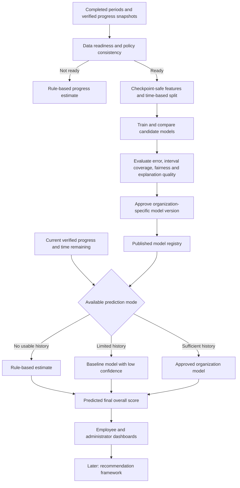

# Prediction Framework implementation plan

Status: **synthetic dataset foundation implemented; prediction runtime not implemented**

Active prototype branch: `codex/prediction-prototype`

Initial prototype organization: KCT

Initial prediction target: final approved overall appraisal score

The implementation-ready Saturday review slice, synthetic-data decisions and refined project structure are maintained in the [Prediction prototype implementation plan](PREDICTION-PROTOTYPE-IMPLEMENTATION-PLAN.md).

## 1. Purpose

The Prediction Framework will let each organization configure, train, test, approve, publish, and monitor its own final-score prediction model. Employees and authorized administrators will see a prediction based on the latest verified appraisal progress and the time remaining in the active cycle.

The framework is organization-neutral. KCT supplies the first prototype configuration and synthetic dataset, but KCT-specific KRA and KPI names must remain configuration data rather than application logic.

The Prediction Framework estimates a future result. It must never change verified evidence, policy calculations, reviewer decisions, or the official final score.

## 2. Initial scope

### Included in the prototype

- One organization profile representing KCT.
- One prediction target: final approved overall score.
- KCT appraisal-cycle, role, KRA, KPI, maximum-score, and policy-version configuration.
- A reproducible synthetic dataset based on KCT's real structure and rules.
- CSV/XLSX upload and column mapping for training data.
- Data quality, policy consistency, and readiness checks.
- Three readiness scenarios: no historical data, limited historical data, and sufficient historical data.
- Candidate-model training, comparison, evaluation, approval, and publication.
- A test sandbox for entering or selecting an employee snapshot.
- A live employee prediction card based on current verified progress.
- A basic administrator view for model status and retraining configuration.
- Organization-scoped model and configuration versions.

### Deferred until after the prototype

- KPI-, KRA-, or risk-area predictions as separate prediction targets.
- Recommendation ranking and action catalogues.
- Real KCT employee data ingestion.
- Automated connectors to ERP, LMS, HRMS, or institutional data warehouses.
- Cross-organization or shared employee models.
- Fully automatic model publication without administrator approval.
- Production authentication, tenant isolation, encrypted storage, durable jobs, and audit infrastructure.
- Causal claims about recommended actions or employee outcomes.

## 3. Core design principles

1. **One framework, separate organization models.** AFPI provides the configuration, training, evaluation, publication, and inference pipeline. Each organization's data, model versions, thresholds, and predictions remain separate.
2. **Official score remains deterministic.** Framework Studio and the approved scoring policy calculate the official score. Prediction only estimates the likely final overall score.
3. **Verified data only.** The official prediction uses verified progress. Unverified submissions may be shown separately as a potential scenario but cannot silently enter the official prediction.
4. **No false machine-learning claim.** When training data is not ready, AFPI shows a transparent rule-based estimate and labels it as an estimate, not an ML prediction.
5. **No data leakage.** A training row may contain only information that was available at that checkpoint. The final approved score is the target, not an input.
6. **Time-based validation.** Earlier completed cycles train candidate models; a later completed cycle tests them.
7. **Human-controlled publication.** Training may be scheduled, but a candidate model is published only after evaluation and authorized approval.
8. **Version everything.** Prediction configuration, source mapping, dataset snapshot, scoring policy, feature schema, algorithm configuration, evaluation, and published model version must be traceable.
9. **KCT is configuration, not hard-coded behavior.** The first dataset and walkthrough may use KCT terminology, while the domain model stays generic.
10. **Prefer established algorithms.** AFPI will build the prediction framework and controls. It should use an established, tested ML implementation unless an evaluation proves that a small transparent implementation is safer and maintainable.

## 4. Architecture alignment

The implementation follows the supplied architecture as two connected paths: model preparation and live prediction.



The top path runs when data is added, a cycle closes, or retraining is requested. The bottom path runs when an authorized user opens a dashboard or verified progress changes. Opening a dashboard runs inference; it does not retrain the model.

## 5. Three prediction scenarios

### Scenario A: no historical data

Condition:

- No completed appraisal cases with both a valid checkpoint snapshot and a final approved overall score, or
- Data fails policy consistency or minimum quality requirements.

Behavior:

- Show a rule-based projection using current verified score, elapsed cycle fraction, time remaining, maximum score, and applicable policy constraints.
- Label the output `Rule-based estimate`.
- Do not show an ML confidence claim.
- Explain the formula and the absence of historical training data.
- Continue collecting checkpoint snapshots for later completed-cycle training.

Illustrative prototype calculation:

```text
pace projection = current verified score / elapsed cycle fraction
estimated final score = clamp(pace projection, current verified score, maximum score)
```

The prototype must test edge cases such as a cycle that has not started, zero elapsed time, a completed cycle, scores above caps, missing progress, and policy changes. The formula is a configurable baseline and not a promise that progress is linear.

### Scenario B: limited historical data

Condition:

- Some usable completed cases exist, but sample size, checkpoint coverage, cycle coverage, subgroup coverage, or policy stability is insufficient for a normal-confidence model.

Behavior:

- Train only simple candidate models that can be evaluated honestly with the available data.
- Publish a model only if it beats the rule-based and naive statistical baselines on held-out data.
- Display `Low confidence`, an expected range, data limitations, training-record count, and model age.
- Fall back to the rule-based estimate if validation is not meaningful or the candidate does not improve on the baseline.

Illustrative prototype readiness band:

- `1-29` usable completed cases: remain rule-based because a meaningful train/test evaluation is unlikely.
- `30-99` usable completed cases: limited-data candidate may be evaluated and, if approved, shown with low confidence.

These numbers are demonstration defaults, not universal production thresholds. Final thresholds must depend on feature count, target variation, checkpoint coverage, policy stability, and measured validation error.

### Scenario C: sufficient historical data

Condition:

- Enough usable completed cases and cycles exist for a time-based holdout.
- Required feature and target coverage passes readiness rules.
- The policy versions are compatible or represented explicitly.
- The candidate model passes accuracy, interval, subgroup, and stability gates.

Behavior:

- Compare multiple approved candidate algorithms.
- Publish the best eligible candidate only after administrator approval.
- Display the predicted final overall score, expected range, confidence band, model version, last-updated time, and a simple explanation.
- Continue monitoring actual final outcomes and retrain according to policy.

Illustrative prototype readiness band:

- `100+` usable completed cases across at least two completed cycles may enter the sufficient-data evaluation path.

Passing the record threshold alone is never sufficient. Data quality and evaluation gates still apply.

## 6. Roles and permissions

| Role | Prototype responsibility | Production direction |
|---|---|---|
| Organization prediction administrator | Configure target, cycle, data mapping, training, evaluation, approval, publication, and retraining | Tenant-scoped permission and authenticated identity |
| Organization reviewer/model approver | Review model evidence and approve or reject a candidate | Separate approval permission and immutable decision record |
| Employee | View only their current verified progress and prediction | Row-level authorization |
| Manager/appraiser | View permitted employee or team predictions | Scope determined by organization hierarchy |
| Platform developer | Maintain algorithms, feature code, adapters, migrations, and safeguards | Cannot access tenant data without explicit operational authorization |

The current application has no authentication. The prototype must therefore use clearly labelled simulated roles and sample employees. It must not imply production authorization.

## 7. Screen architecture

### Screen 1: Prediction overview

Purpose: show the organization's prediction setup and lifecycle state.

Content:

- Prediction name and organization.
- Target: `Final approved overall score`.
- Active appraisal cycle.
- Current mode: rule-based, limited-data model, or organization model.
- Data-readiness summary.
- Draft, candidate, approved, published, or retired model status.
- Last trained, last published, next eligible retraining, and current model version.
- Clear next action such as Configure, Add data, Train, Review, Test, or Publish.

Prototype: required.

### Screen 2: Prediction configuration

Purpose: define what will be predicted and its operating context.

Sections:

- Organization and configuration name.
- Prediction target; only overall final score is enabled in the first prototype.
- Maximum score and score scale.
- Applicable roles/designations.
- Appraisal-cycle start and end rules.
- Checkpoint schedule: monthly, selected percentages, or organization-defined dates.
- Runtime update triggers: dashboard open, verified-score change, scheduled refresh.
- Feature inclusion choices.
- Rule-based projection method and caps.
- Visibility policy for employees, managers, and administrators.
- Minimum readiness profile selection.

Validation:

- End date must follow start date.
- Maximum score must agree with the selected scoring-policy version.
- At least one checkpoint must occur before cycle completion.
- The target cannot be configured from an unapproved score source.

Prototype: required.

### Screen 3: Data source and mapping

Purpose: add historical data and map organization columns to the AFPI prediction schema.

Prototype sources:

- Generated synthetic KCT dataset.
- CSV upload.
- XLSX upload.

Later sources:

- Database views.
- HRMS/LMS/ERP connectors.
- AFPI's durable appraisal store.

Functions:

- Upload or select a source.
- Preview rows without exposing unnecessary personal identifiers.
- Map columns to required AFPI fields.
- Select date formats, score scales, missing-value markers, and categorical values.
- Validate types and ranges.
- Save a versioned mapping profile.
- Produce an import summary and rejected-row file.

Prototype: required.

### Screen 4: Data readiness and quality

Purpose: decide which of the three prediction scenarios is allowed.

Checks:

- Number of usable completed employees/cases.
- Number of completed appraisal cycles.
- Checkpoint coverage at each configured point.
- Presence of final approved overall score.
- Missing values and invalid ranges.
- Duplicate employee-cycle-checkpoint rows.
- Framework and scoring-policy version coverage.
- Target distribution and outliers.
- Role/designation coverage.
- Leakage checks for post-checkpoint information.
- Whether a time-based train/test split is possible.

Output:

- Scenario A, B, or C.
- Blocking errors, warnings, and suggested corrections.
- Eligible training and testing row counts.
- Data snapshot ID used by the next training run.

Prototype: required.

### Screen 5: Train and compare models

Purpose: run approved candidate algorithms on one frozen dataset and feature definition.

Functions:

- Display the dataset, mapping, policy, and feature versions.
- Choose only algorithms allowed by the platform's registry.
- Start a training run.
- Show queued, running, succeeded, failed, or cancelled state.
- Compare each candidate with the rule-based projection and naive baselines.
- Keep training logs free of personal data.
- Preserve parameters, seed, timings, warnings, and artifact checksums.

Prototype: required. The prototype may run synchronously or as a simulated job, but interfaces should support durable jobs later.

### Screen 6: Model evaluation and approval

Purpose: decide whether a candidate is safe and useful enough to publish.

Required evidence:

- Mean absolute error (MAE).
- Root mean squared error (RMSE).
- Error as a percentage of the overall score range.
- Prediction-interval coverage and average interval width.
- Comparison with rule-based and naive baselines.
- Error by configured role/designation where sample size permits.
- Large-error examples without personal identifiers.
- Feature/explanation compatibility.
- Training and test period boundaries.
- Known limitations and confidence classification.

Decisions:

- Approve candidate.
- Reject candidate with a reason.
- Return to data/configuration.
- Keep the existing published model.

Prototype: required.

### Screen 7: Prediction test sandbox

Purpose: test the approved candidate before publication.

Functions:

- Select a synthetic sample employee or enter a checkpoint snapshot.
- Show validation errors for impossible values.
- Run Scenario A, B, or C intentionally for demonstration.
- Display current verified score, elapsed time, predicted final score, range, confidence/method label, model version, and explanation.
- Compare the candidate result with the rule-based estimate.
- Confirm that prediction does not alter the official score.

Prototype: required.

### Screen 8: Publish model

Purpose: activate an approved model for an organization.

Functions:

- Confirm target, organization, applicable framework/policy versions, roles, cycle, and visibility.
- Select activation time.
- Record approver and approval note in the simulated prototype audit record.
- Publish immutably as a new version.
- Keep the prior model available for rollback.
- Fall back safely when the current employee is outside the model's supported scope.

Prototype: required.

### Screen 9: Employee prediction dashboard

Purpose: show a clear, current, non-authoritative prediction.

Content:

- Current verified score and maximum score.
- Appraisal-cycle progress and time remaining.
- Predicted final overall score.
- Expected range.
- Method: rule-based estimate, limited-data model, or organization model.
- Confidence: low, medium, or high only for evaluated models.
- Main contributing progress factors in plain language.
- Last calculated time and model version.
- A notice that the value is decision support and not the official final score.

Runtime triggers:

- Calculate when the dashboard opens if the cached prediction is stale.
- Recalculate when verified progress or the active policy version changes.
- Do not train a model during dashboard access.

Prototype: required with synthetic employees and simulated login context.

### Screen 10: Monitoring and retraining

Purpose: control when completed real data can produce a new candidate model.

Configuration:

- Manual retraining.
- After appraisal-cycle closure.
- After a configurable number of new completed cases.
- Optional periodic readiness check.
- Minimum new cases and minimum completed-cycle coverage.
- Whether an approved existing model continues during training.
- Required approval before publication.

Monitoring:

- Prediction versus final-score error after outcomes become available.
- Input/data drift warnings.
- Policy-version incompatibility.
- Model age and supported scope.
- Failed inference or out-of-scope rates.

Prototype: basic schedule configuration and simulated retraining run. Full automated monitoring is deferred.

## 8. Data contract

### Required organization configuration

| Field | Purpose |
|---|---|
| `organizationId` | Tenant boundary and model ownership |
| `predictionConfigId` | Stable prediction configuration identity |
| `frameworkVersionId` | KRA/KPI structure used by a case |
| `scoringPolicyVersionId` | Rules that produced verified and final scores |
| `cycleId` | Appraisal period identity |
| `cycleStart` / `cycleEnd` | Calculate elapsed and remaining time |
| `maximumOverallScore` | Output range and normalization |
| `applicableRoles` | Scope and evaluation groups |

### Required training row

Each row represents one employee at one checkpoint, paired with the final approved outcome from the same completed cycle.

| Field | Type | Notes |
|---|---|---|
| `organization_id` | string | Required; never mix organizations |
| `employee_key` | string | Pseudonymous synthetic/stable key |
| `role_code` | string | Organization-defined role |
| `cycle_id` | string | Completed appraisal cycle |
| `framework_version_id` | string | Required for compatibility checks |
| `policy_version_id` | string | Required for consistency checks |
| `checkpoint_at` | date-time | When the snapshot was valid |
| `elapsed_fraction` | number 0-1 | Derived from cycle dates |
| `time_remaining_days` | non-negative integer | Derived at checkpoint |
| `current_verified_score` | number | Information available at checkpoint |
| `maximum_overall_score` | positive number | Normalization and cap |
| `verified_progress_ratio` | number 0-1 | Current score divided by maximum, where applicable |
| `verified_evidence_count` | non-negative integer | Optional prototype feature |
| `pending_evidence_count` | non-negative integer | Optional; never treated as verified score |
| `checkpoint_sequence` | positive integer | Supports progression order |
| `final_approved_overall_score` | number | Training target; available only after cycle closure |
| `finalized_at` | date-time | Proves target availability timing |

KRA/KPI progress may be included as a versioned feature vector after KCT mapping is agreed. The first public output remains only the final overall score.

### Runtime prediction request

```json
{
  "organizationId": "org-kct-demo",
  "employeeKey": "faculty-demo-001",
  "cycleId": "cycle-2026-demo",
  "frameworkVersionId": "framework-kct-v1",
  "policyVersionId": "policy-kct-v1",
  "checkpointAt": "2026-10-27T10:00:00.000Z",
  "currentVerifiedScore": 72,
  "maximumOverallScore": 200,
  "elapsedFraction": 0.5,
  "timeRemainingDays": 182,
  "verifiedEvidenceCount": 8,
  "pendingEvidenceCount": 2
}
```

The example is illustrative synthetic data, not a real employee record.

### Runtime prediction response

```json
{
  "method": "limited-data-model",
  "predictedFinalOverallScore": 138,
  "lowerBound": 126,
  "upperBound": 150,
  "confidence": "low",
  "modelVersion": "prediction-kct-v1",
  "calculatedAt": "2026-10-27T10:00:01.000Z",
  "officialScoreChanged": false,
  "explanations": [
    "Verified progress is slightly ahead of the expected pace.",
    "The model has limited completed historical cases."
  ],
  "warnings": [
    "This is an experimental prediction, not an official score."
  ]
}
```

## 9. Synthetic KCT dataset plan

### Inputs required from the project owner

- Current KCT KRA names and identifiers.
- KPI definitions under each KRA.
- Applicable faculty roles/designations.
- Maximum scores, weights, caps, thresholds, and contribution rules.
- Appraisal-cycle dates and checkpoint expectations.
- Rules for verified, pending, rejected, and missing evidence.
- Any role-specific applicability rules.
- Optional anonymized aggregate distributions, if KCT can share them safely.

### Generation process

1. Encode the supplied KCT structure as a versioned configuration fixture.
2. Define synthetic roles, cycles, checkpoints, and sample sizes.
3. Generate plausible employee progression profiles such as steady, early, late, improving, stalled, and irregular.
4. Generate KPI/KRA progress within configured score limits.
5. Apply the actual configured scoring policy to calculate checkpoint verified scores.
6. Generate final completed outcomes using documented noise and completion assumptions.
7. Add controlled missing values, rejected rows, late evidence, policy changes, and outliers for readiness testing.
8. Preserve a deterministic random seed so tests can reproduce the dataset.
9. Mark every file and row as synthetic.
10. Produce separate datasets for Scenario A, Scenario B, and Scenario C demonstrations.

### Proposed synthetic fixtures

| Fixture | Purpose |
|---|---|
| `kct-no-history.json` | Current employee snapshots only; triggers Scenario A |
| `kct-limited-history.csv` | Small completed history; exercises Scenario B and low-confidence/fallback behavior |
| `kct-sufficient-history.csv` | Multiple completed synthetic cycles; exercises Scenario C |
| `kct-invalid-history.csv` | Missing targets, duplicates, impossible dates/scores, and policy mismatches |
| `kct-prediction-cases.json` | Expected sandbox and automated test cases |

Synthetic results validate software behavior, not real KCT model accuracy.

## 10. Feature engineering

### Initial generic features

- Elapsed appraisal fraction.
- Days remaining.
- Current verified overall score.
- Overall score maximum.
- Current verified-score ratio.
- Difference between verified progress and expected linear pace.
- Verified and pending evidence counts.
- Previous automatically captured checkpoint score, when available.
- Score change since the previous checkpoint.
- Checkpoint sequence.
- Role/designation encoded from the organization configuration.
- Framework and policy version compatibility flags.

### Why previous checkpoints help

Two employees may currently have the same score but different progress direction. Earlier checkpoints distinguish rapid improvement, steady progress, and stalled progress. The system captures them automatically; employees do not type them manually.

Previous checkpoints are optional for the first rule-based prototype. A trained candidate may use them only if historical checkpoint coverage is sufficient and the feature improves held-out performance.

### Leakage exclusions

- Final score or any component finalized after the selected checkpoint.
- Reviewer decisions made after the checkpoint.
- Evidence added or verified after the checkpoint.
- Future checkpoint scores.
- Recommendation acceptance or later outcomes.
- Data derived from the test cycle during training.

## 11. Algorithm selection strategy

The algorithm is deliberately not fixed in this plan. It will be selected through a documented evaluation after the data contract and synthetic fixtures are ready.

### What AFPI builds

- Organization configuration and isolation.
- Data ingestion, mapping, readiness, and leakage controls.
- Feature generation.
- Training orchestration and candidate registry.
- Evaluation, approval, publication, inference, monitoring, fallback, and audit records.
- User interfaces and explanations.

### What AFPI should normally reuse

- Established regression algorithms from a maintained ML library or isolated model service.
- Tested serialization and inference formats.
- Explanation implementations compatible with the chosen model.

### Candidate algorithms for the prototype evaluation

1. Rule-based pace projection; mandatory fallback and comparison baseline.
2. Historical mean/median or role-and-checkpoint grouped baseline.
3. Regularized linear regression; preferred first transparent ML candidate.
4. Tree ensemble such as random forest or gradient boosting if enough data exists and it materially improves held-out error.

### Selection rule

Choose the simplest candidate that:

- Beats the rule-based and naive baselines on a time-based holdout.
- Produces acceptable MAE/RMSE relative to the 200-point or configured score range.
- Supports an honest expected range.
- Does not show unacceptable subgroup error where evaluation is statistically meaningful.
- Can be explained and reproduced.
- Can be deployed safely in the chosen application architecture.

Do not build a custom novel ML algorithm for the prototype. A custom algorithm adds validation and maintenance risk without improving the product's main contribution, which is the configurable, organization-specific prediction framework.

## 12. Confidence and expected range

Confidence must not be calculated only from record count. It should consider:

- Amount and cycle coverage of training data.
- Held-out prediction error.
- Prediction-interval coverage.
- Missing runtime inputs.
- Whether the employee is within the model's supported roles, score range, cycle stage, framework version, and policy version.
- Distance from patterns represented in training data.
- Model age and drift warnings.

Prototype display:

- Scenario A: `Rule-based estimate`; no ML confidence.
- Scenario B: `Low confidence` when an approved limited-data model is used.
- Scenario C: Low, medium, or high only from documented evaluation thresholds.

The numerical expected range should be shown alongside the label because the label alone is not sufficiently informative.

## 13. Model lifecycle

```text
Draft configuration
  -> Data mapped
  -> Readiness checked
  -> Training run
  -> Candidate model
  -> Evaluated
  -> Approved or rejected
  -> Published
  -> Monitored
  -> Replaced or retired
```

Allowed statuses:

- `draft`
- `data_blocked`
- `ready`
- `training`
- `training_failed`
- `candidate`
- `rejected`
- `approved`
- `published`
- `superseded`
- `retired`

Only one published model may be active for the same organization, prediction target, framework/policy compatibility scope, and cycle context. Publishing a replacement supersedes rather than deletes the earlier model.

## 14. Retraining policy

### Default prototype configuration

- Readiness check after an appraisal cycle closes.
- Retraining eligible after at least 100 new usable completed cases, configurable for demonstration.
- Manual retraining remains available.
- The current published model stays active while a candidate trains.
- Administrator approval is always required before publication.
- Failed or worse candidates do not replace the current model.

### Correct use of current-cycle data

- During an active cycle, current verified data is used for live inference.
- Checkpoint snapshots are stored for possible future training.
- The same snapshots become labelled training cases only after the cycle closes and a final approved overall score exists.
- A fresh organization stays on Scenario A until enough completed, compatible data supports Scenario B or C.

## 15. Proposed project structure

The following structure is planned; directories are introduced only when implementation begins.

```text
app/
  prediction/
    page.jsx                         # Prediction Studio entry
  api/
    prediction/
      readiness/route.js             # Validate mapped dataset and choose scenario
      training/route.js              # Start/list prototype training runs
      training/[runId]/route.js      # Training status and evaluation
      models/route.js                # Candidate and published model registry
      models/[modelId]/approve/route.js
      models/[modelId]/publish/route.js
      predict/route.js               # Runtime overall-score inference

src/
  prediction/
    PredictionStudio.jsx             # Screen navigation and organization context
    PredictionOverview.jsx
    PredictionConfigForm.jsx
    DataSourceStudio.jsx
    DataMappingEditor.jsx
    DataReadinessReport.jsx
    ModelTrainingStudio.jsx
    ModelEvaluation.jsx
    PredictionSandbox.jsx
    ModelPublishPanel.jsx
    EmployeePredictionCard.jsx
    RetrainingSettings.jsx
    prediction.css

    domain/
      predictionConfig.js            # Configuration schema and validation
      predictionDataset.js           # Canonical row parsing and validation
      readiness.js                   # Scenario A/B/C selection
      features.js                    # Checkpoint-safe feature generation
      ruleBasedEstimate.js           # Transparent Scenario A fallback
      confidence.js                  # Range/confidence classification
      modelLifecycle.js              # Status transitions
      modelRegistry.js               # Prototype registry interface
      predictionService.js           # Runtime mode selection and response

server/
  prediction/
    trainingService.js               # Candidate orchestration
    evaluationService.js             # Metrics and comparison gates
    modelArtifactStore.js            # Storage interface
    predictionRepository.js          # Config/run/model/prediction interface
    adapters/
      localPrototypeRepository.js    # Prototype-only adapter
      mlProvider.js                  # Algorithm-provider interface

scripts/
  generate-kct-prediction-data.mjs    # Seeded synthetic dataset generator
  validate-prediction-fixtures.mjs

fixtures/
  prediction/
    kct/
      framework-config.json
      kct-no-history.json
      kct-limited-history.csv
      kct-sufficient-history.csv
      kct-invalid-history.csv
      kct-prediction-cases.json

docs/
  PREDICTION-FRAMEWORK-IMPLEMENTATION-PLAN.md
  PREDICTION-DATA-DICTIONARY.md        # Added with the implemented schema
  PREDICTION-USER-GUIDE.md             # Added with usable screens
```

Tests should be colocated with existing conventions, for example `src/prediction/*.test.js` and `server/prediction/*.test.js`.

## 16. Planned interfaces

### Repository interfaces

- `PredictionConfigRepository`: save and load versioned organization configuration.
- `DatasetSnapshotRepository`: retain mapping, validation report, checksum, and frozen training snapshot metadata.
- `TrainingRunRepository`: retain run state, parameters, seed, logs, metrics, and failures.
- `ModelRegistry`: retain candidate, approval, published, superseded, and retired versions.
- `PredictionRecordRepository`: retain request snapshot, response, method, version, and timestamps where policy allows.

The prototype may use local fixture/in-memory adapters. Production integration requires database-backed, tenant-scoped implementations.

### ML provider interface

The prediction framework must not depend directly on one algorithm package. A provider should support:

- `train(trainingRows, validationRows, featureSchema, options)`
- `evaluate(modelArtifact, testRows)`
- `predict(modelArtifact, runtimeFeatures)`
- `explain(modelArtifact, runtimeFeatures)` where supported
- `serialize(modelArtifact)` and `load(serializedArtifact)`
- Algorithm name, version, parameters, and deterministic seed metadata

## 17. Integration with Framework Studio and scoring

Framework Studio remains responsible for:

- KRA/KPI definitions.
- Evidence collection and verification workflows.
- Scoring-policy versions.
- Verified current score and official final score calculation.

The Prediction Framework consumes immutable snapshots containing:

- Organization, employee, cycle, framework version, and policy version.
- Checkpoint timestamp.
- Current verified progress and score.
- Time elapsed and remaining.
- Final approved overall score only after cycle closure for training.

The Prediction Framework returns an advisory prediction. It must not write to the scoring calculation, evidence facts, workflow trace, or final approved score.

The future Recommendation Framework may consume predicted gaps, but that integration is not part of this prototype's output contract.

## 18. API and validation behavior

### Readiness endpoint

- Accepts a dataset snapshot reference and mapping version.
- Rejects cross-organization references.
- Returns scenario, usable/rejected counts, blocks, warnings, and eligible split periods.

### Training endpoint

- Requires a ready snapshot and versioned configuration.
- Freezes feature and policy metadata.
- Prevents duplicate concurrent runs for the same snapshot/configuration unless explicitly retried.
- Returns a run ID and status.

### Prediction endpoint

- Validates organization and model scope.
- Loads current verified progress from the supplied trusted adapter in production.
- Selects Scenario A, B, or C.
- Clamps output to the configured valid score range.
- Returns method, score, interval, confidence/method label, explanations, warnings, and version metadata.
- Never returns another employee's data or a cross-organization model.

## 19. Security and privacy requirements

- Keep organization datasets and models isolated.
- Use pseudonymous employee keys for training.
- Do not place names, email addresses, evidence text, or uploaded documents in model features unless separately justified and approved.
- Do not log raw training rows or prediction requests.
- Validate uploaded file type, size, headers, row count, and formulas before import.
- Treat spreadsheet formulas and external links as untrusted input.
- Define retention and deletion for datasets, training runs, models, and predictions before real data is used.
- Record who configured, trained, approved, published, rolled back, and retired each model in production.
- Prevent an administrator from viewing employee predictions outside their authorized scope.
- Keep synthetic fixtures clearly labelled and free of real personal data.

## 20. Testing strategy

### Unit tests

- Configuration validation.
- Cycle elapsed/remaining calculations.
- Rule-based projection and caps.
- Dataset parsing and column mapping.
- Missing/invalid/duplicate row handling.
- Readiness scenario selection.
- Policy-version compatibility.
- Checkpoint-safe feature generation.
- Leakage exclusions.
- Confidence/method labels.
- Model lifecycle transitions.
- Runtime fallback and score clamping.

### Integration tests

- Synthetic CSV/XLSX import through readiness report.
- Scenario A live estimate.
- Scenario B candidate failure and successful low-confidence publication.
- Scenario C time-based training/evaluation/publication.
- Candidate does not replace a published model before approval.
- Current-cycle checkpoint becomes training data only after finalization.
- Model/version mismatch falls back safely.
- Employee dashboard uses only the permitted synthetic employee.

### Browser acceptance tests

- Configure a KCT prediction target.
- Upload/map each synthetic fixture.
- Correct invalid mappings and rerun readiness.
- Train, compare, approve, test, and publish a model.
- Log in as a simulated employee and view a live prediction.
- Update verified progress and confirm prediction refresh.
- Confirm official score does not change.
- Configure retraining and simulate a cycle closure.

### Model-quality tests

- Reproducible result for the same seed and frozen dataset.
- Time-based holdout remains separate from training.
- Candidate compared with rule and naive baselines.
- MAE, RMSE, range-normalized error, and interval coverage reported.
- Subgroup metrics suppressed when sample size is too small for a meaningful claim.
- Out-of-scope runtime input produces a warning or fallback rather than an unsupported confident prediction.

## 21. Implementation phases and exit criteria

### Phase 0: KCT data definition

Deliverables:

- Approved KCT KRA/KPI and scoring-policy mapping.
- Prediction data dictionary.
- Checkpoint and final-outcome definitions.
- Synthetic-data assumptions and privacy review.

Exit: every required field has an owner, source, type, timing rule, and validation rule.

### Phase 1: synthetic dataset and readiness engine

Deliverables:

- Seeded generator and four scenario/invalid fixtures.
- Mapping schema and validation.
- Scenario A/B/C readiness selection.
- Automated dataset tests.

Exit: fixtures reproduce reliably and each triggers the expected readiness result.

### Phase 2: Prediction Studio foundation

Deliverables:

- Prediction overview and configuration screens.
- Simulated organization/role context.
- Versioned prototype configuration storage.
- Data source, mapping, and readiness screens.

Exit: an administrator can configure KCT and obtain a readiness report without training a model.

### Phase 3: rule-based live prediction

Deliverables:

- Scenario A calculation service.
- Test sandbox.
- Employee prediction card.
- Runtime refresh on verified progress change.

Exit: a synthetic employee receives a transparent estimate, and the official score remains unchanged.

### Phase 4: algorithm evaluation spike

Deliverables:

- ML provider interface.
- Naive, linear, and selected tree candidate adapters where technically feasible.
- Time-based evaluation report using synthetic data.
- Documented algorithm/library decision.

Exit: the team selects the simplest viable implementation or explicitly retains rule-only mode.

### Phase 5: training, evaluation, approval, and publication

Deliverables:

- Training and candidate comparison screen.
- Evaluation and approval screen.
- Model lifecycle and registry.
- Publish/rollback behavior.
- Scenario B and C runtime selection.

Exit: approved candidates can be published and unapproved candidates cannot reach employees.

### Phase 6: dashboard integration

Deliverables:

- Employee and administrator prediction views.
- Staleness and refresh rules.
- Plain-language explanation and method/confidence labels.
- Scope/version mismatch fallback.

Exit: all three scenarios are demonstrable end to end through the UI.

### Phase 7: monitoring and retraining

Deliverables:

- Retraining settings.
- Simulated cycle-close eligibility.
- Candidate comparison with the current published model.
- Manual approval and rollback evidence.

Exit: current-cycle snapshots are not used as labels before closure, and a worse candidate cannot replace the active model.

### Phase 8: real-data readiness and recommendation handoff

Deliverables:

- Real KCT data-governance checklist.
- Production storage/authentication design.
- Validated import plan.
- Future risk/gap output contract for recommendations.

Exit: institutional approval exists before any real employee data is imported. Recommendation development starts only after the prediction output contract is stable.

## 22. Prototype screen filter

| Screen | Prototype decision |
|---|---|
| Prediction overview | Build |
| Prediction configuration | Build |
| Data source and mapping | Build |
| Data readiness and quality | Build |
| Train and compare | Build |
| Evaluation and approval | Build |
| Test sandbox | Build |
| Publish model | Build |
| Employee dashboard | Build |
| Monitoring and retraining | Build basic version |
| Advanced drift analytics | Defer |
| Connector administration | Defer |
| Recommendation configuration | Defer |

## 23. Prototype acceptance criteria

The prediction prototype is complete when:

1. KCT KRA/KPI and scoring rules are represented through configuration rather than hard-coded conditions.
2. Synthetic Scenario A, B, C, and invalid datasets are reproducible and labelled.
3. An administrator can configure the target, cycle, features, data source, and retraining rules.
4. Readiness correctly selects or blocks each scenario.
5. Candidate algorithms are compared against transparent baselines with a time-based split.
6. Only an approved, published candidate is used for model-based employee predictions.
7. The sandbox demonstrates all three scenarios.
8. Employees see the current verified score, predicted final score, range, method/confidence, explanation, and timestamp.
9. Updating verified progress refreshes inference without retraining.
10. No prediction changes the official score.
11. Current-cycle rows cannot become labelled training data until a final approved score exists.
12. Documentation, tests, and limitations match the implemented behavior.

## 24. Decisions required before implementation

The following must be resolved with the project owner during the relevant phase:

- Exact KCT KRA/KPI structure, score range, caps, roles, and policy versions.
- Definition of a verified checkpoint snapshot.
- Which checkpoint dates or percentages should be captured.
- Whether limited-data model publication is allowed or Scenario B remains rule-based until stronger data exists.
- Prototype readiness thresholds and minimum subgroup size.
- Acceptable prediction error relative to the configured score range.
- Expected-range and confidence calculation.
- ML library/runtime after the Phase 4 spike.
- Which explanations are understandable and safe for employees.
- Who approves and who can view predictions in the future production system.
- Storage and deployment architecture before real data is accepted.

## 25. Immediate next actions

1. Obtain the current KCT KRAs, KPIs, scoring rules, roles, cycle dates, and maximum overall score.
2. Confirm the checkpoint schedule and meaning of final approved score.
3. Create the prediction data dictionary and KCT configuration fixture.
4. Agree synthetic-data assumptions and demonstration sample sizes.
5. Implement Phase 1 before designing model-specific UI details.
6. Use Phase 4 evidence to choose an existing algorithm/library; do not lock the final model earlier.

