# Prediction prototype implementation plan

Status: **Phase 1 dataset foundation implemented; screens, readiness, training and prediction not started**

Implementation branch: `codex/prediction-prototype`

Initial organization: KCT

Policy source: PADS configuration

Initial target: final approved overall score out of 200

Review goal: demonstrate configuration → synthetic data → readiness → training → testing → approval → live prediction

This document is the implementation-ready delivery plan for the first end-to-end review prototype. The broader product architecture, production safeguards, three readiness scenarios, lifecycle and long-term phases remain defined in the [Prediction Framework implementation plan](PREDICTION-FRAMEWORK-IMPLEMENTATION-PLAN.md).

The seeded KCT/PADS KRA-level generator and no-history, limited-history, sufficient-history and invalid fixtures were implemented on 29 October 2026. The [prediction data dictionary](PREDICTION-DATA-DICTIONARY.md) records the canonical schema. Dataset configuration screens, readiness, model training, approval, prediction and employee views remain planned.

## 1. Prototype outcome

The review prototype must let a reviewer see the complete prediction journey without using real employee data:

1. Configure how synthetic appraisal history should be generated.
2. Generate reproducible KCT/PADS-shaped synthetic records.
3. Preview and validate the generated data.
4. Choose checkpoint-safe model inputs and a time-based split.
5. Train established regression algorithms.
6. Compare candidates against transparent baselines.
7. Approve and publish one demonstration model.
8. Test a current faculty snapshot.
9. View the resulting prediction as a simulated employee.

The prototype demonstrates software behavior and architecture. It does not establish real KCT prediction accuracy.

## 2. Locked decisions

| Area | Prototype decision |
|---|---|
| Prediction target | Final approved overall score, constrained to `0–200` for the KCT fixture |
| Policy source | PADS KRAs, KPIs, role caps, mandatory conditions and scoring rules represented as versioned configuration |
| Real employee data | Not used |
| Synthetic generation | Seeded, reproducible and policy-aware; never arbitrary independent random scores |
| Training unit | One faculty-cycle-checkpoint row with the completed cycle's final approved score as the target |
| Validation split | Earlier completed cycles for training; a later completed cycle for testing |
| Algorithms | Pace baseline, grouped historical baseline, regularized linear regression, random forest and gradient boosting |
| Model implementation | Established scikit-learn implementations behind a provider boundary |
| Model ownership | The trained KCT artifact is organization-specific; the algorithm remains reusable |
| Publication | Explicit simulated administrator approval is required |
| Employee output | Predicted final score, expected range, method/confidence label, contributing factors, model version and timestamp |
| Recommendation module | Not included |

## 3. Scope boundaries

### Included

- KCT organization and PADS policy fixture.
- The eight synthetic-dataset decisions described in section 7.
- Dataset generation, preview and CSV download.
- No-history, limited-history, sufficient-history and invalid-data fixtures.
- Readiness and data-quality checks.
- Model configuration, training, testing and comparison.
- Candidate approval and prototype publication.
- Prediction sandbox and simulated employee dashboard.
- Basic retraining schedule configuration for demonstration.
- Local prototype storage and downloadable metadata.

### Excluded

- Real faculty data.
- Claims about production model accuracy, fairness or readiness.
- Production authentication, tenant isolation, database storage or durable training jobs.
- Automatic publication of a newly trained model.
- KPI/KRA-level prediction targets.
- Recommendation generation.
- ERP, LMS, HRMS or data-warehouse connectors.
- Cloud model hosting or production deployment of the Python service.

## 4. Architecture

The prototype keeps deterministic appraisal logic separate from statistical prediction.

```mermaid
flowchart LR
  FS[Framework Studio configuration] --> PC[PADS policy configuration]
  PC --> SG[Synthetic data generator]
  SG --> DS[Frozen dataset snapshot]
  DS --> DR[Readiness and quality checks]
  DR --> FM[Checkpoint-safe feature matrix]
  FM --> ML[Established ML candidates]
  ML --> EV[Time-based evaluation]
  EV --> AP[Administrator approval]
  AP --> MR[Published prototype model]

  CP[Current verified checkpoint] --> PS[Prediction service]
  MR --> PS
  PS --> SB[Prediction sandbox]
  PS --> ED[Employee dashboard]
```



Responsibilities:

- Framework Studio defines evidence workflows and scoring-policy versions.
- The PADS fixture describes KCT roles, KRAs, KPIs, caps and mandatory conditions.
- The generator simulates policy-valid faculty progress and cycle completion.
- The readiness layer validates the frozen dataset and chooses Scenario A, B or C.
- The ML service trains and evaluates established algorithms.
- The prediction service selects the approved model or safe fallback.
- Prediction never modifies the official deterministic score.

## 5. Prototype screens

### Screen 1: Prediction overview

Shows organization, prediction target, active policy version, dataset status, readiness scenario, candidate/published model and the next required action.

### Screen 2: Synthetic dataset setup

An eight-step wizard containing:

1. Prediction target.
2. Data unit and checkpoint schedule.
3. Input fields.
4. Performance patterns.
5. History scenarios.
6. Dataset size.
7. Data-quality cases.
8. Train/test structure.

The final review panel displays the complete configuration, seed and estimated row count before generation.

### Screen 3: Dataset preview and readiness

Shows:

- Generated faculty, cycles and checkpoint rows.
- Synthetic-data label and generation seed.
- Column definitions and sample values.
- Usable and rejected row counts.
- Missing, duplicate, invalid and incompatible-policy findings.
- Selected readiness scenario and blocking reasons.
- CSV download and regenerate actions.

### Screen 4: Model configuration

Allows the administrator to:

- Confirm the final-score target.
- Select permitted checkpoint-safe inputs.
- Review automatically excluded leakage fields.
- Confirm training and test cycles.
- Select candidate algorithms.
- Set a deterministic training seed.

### Screen 5: Train and compare

Shows training status and a comparison table containing:

- Algorithm and parameters.
- Training and test row counts.
- MAE, RMSE and R².
- Error relative to the 200-point range.
- Comparison against pace and grouped baselines.
- Training duration and warnings.
- Candidate eligibility and recommended candidate.

### Screen 6: Evaluation and approval

Displays the candidate's data snapshot, feature schema, metrics, role-level diagnostics where sample size permits, limitations and synthetic-only warning. The simulated approver may approve or reject the candidate with a note.

### Screen 7: Publish model

Publishes only an approved candidate. It records the model version, algorithm, configuration checksum, dataset checksum, approval, publication time and compatibility scope. Replacing an active model supersedes rather than deletes it.

### Screen 8: Prediction sandbox

The reviewer selects a synthetic employee checkpoint or enters a valid current snapshot. The screen returns:

- Current verified score.
- Predicted final overall score.
- Expected range.
- Method and confidence label.
- Top contributing inputs or plain-language factors.
- Model/policy version and timestamp.
- Warning that the result is synthetic and advisory.

### Screen 9: Employee prediction view

Shows only the selected simulated employee's current score, predicted final score, expected range, time remaining, progress by KRA, explanation and last refresh time. It must not expose model administration or another employee's records.

### Screen 10: Retraining settings

Provides a basic demonstration configuration:

- Manual or cycle-close eligibility.
- Minimum number of new completed cases.
- Evaluation required before replacement.
- Explicit approval required before publication.
- Current model remains active while a new candidate is trained.

## 6. PADS configuration contract

PADS information must be converted into configuration rather than embedded in component logic.

```text
Organization
  └── Appraisal policy version
      ├── Overall score range and cap
      ├── Roles and role-specific KRA caps
      ├── KRAs with stable IDs
      ├── KPIs with stable IDs
      ├── KPI scoring bands and evidence rules
      ├── Mandatory eligibility conditions
      ├── Appraisal cycle definition
      └── Checkpoint schedule
```

The initial fixture may use the PADS workbook available for planning, but the current institution-approved KRA/KPI and scoring definitions must be confirmed before the fixture is treated as authoritative.

## 7. Eight synthetic-dataset decisions

### 7.1 Prediction target

- Field: `final_approved_score`.
- Valid prototype range: `0–200`.
- Available only for completed cycles.
- Never used as an input feature.
- Generated by applying the configured PADS scoring policy to the completed synthetic evidence/outcomes.

### 7.2 Data unit

The canonical training row is one checkpoint for one synthetic faculty member in one appraisal cycle:

```text
organization + employee + cycle + checkpoint → current verified progress → final approved score
```

Recommended checkpoint schedule for the first fixture: `25%`, `50%`, `75%` and `100%` of the cycle. The schedule remains configurable.

### 7.3 Input fields

Required identity and compatibility fields:

| Field | Purpose | Model feature |
|---|---|---|
| `organization_id` | Tenant/configuration identity | No |
| `policy_version` | Scoring compatibility | No; filter/scope only |
| `framework_version` | Workflow compatibility | No; filter/scope only |
| `cycle_id` | Time-based splitting | No |
| `employee_key` | Pseudonymous grouping | No |
| `role_code` | Role-specific behavior and caps | Yes, encoded |
| `checkpoint_index` | Checkpoint order | Yes |
| `checkpoint_date` | Temporal validation | No direct timestamp feature |
| `elapsed_fraction` | Portion of cycle completed | Yes |
| `remaining_days` | Time remaining | Yes |
| `current_overall_score` | Verified score at checkpoint | Yes |
| `previous_overall_score` | Earlier checkpoint score | Yes when available |
| `score_change` | Current minus previous score | Yes |
| `verified_evidence_count` | Completed verified evidence | Yes |
| `mandatory_status` | Mandatory-condition state | Yes, encoded |
| `kra_<stable_id>_score` | Current verified KRA score | Yes |
| `kra_<stable_id>_cap` | Applicable role/policy cap | Yes or normalization input |
| `missing_feature_count` | Runtime data completeness | Readiness/confidence |
| `final_approved_score` | Completed-cycle target | Target only |
| `is_synthetic` | Prevent accidental real-data claims | No; must always be true |

KPI-level generated events may be retained in a separate detail fixture. The first model matrix uses stable KRA-level aggregates to keep feature count proportional to the synthetic sample size.

### 7.4 Performance patterns

Every synthetic faculty-cycle receives one declared pattern:

| Pattern | Intended progression |
|---|---|
| `steady` | Similar progress during each period |
| `early_fast` | Strong early progress followed by slower gains |
| `late_improvement` | Low early score with stronger later completion |
| `stalled` | Early gains followed by little or no progress |
| `irregular` | Uneven gains across periods and KRAs |
| `high_consistent` | Strong progress sustained across the cycle |
| `low_consistent` | Limited progress sustained across the cycle |
| `evidence_delayed` | Activity occurs but verification is delayed until later checkpoints |

Pattern proportions are configurable and visible in generated metadata.

### 7.5 Three history scenarios

| Fixture | Completed cases | Behavior |
|---|---:|---|
| No history | `0` | Current active snapshots only; forces Scenario A rule-based estimate |
| Limited history | `60` | Two completed cycles plus current snapshots; evaluates simple candidates and low-confidence behavior |
| Sufficient history | `240` | Four completed cycles plus current snapshots; supports time-based candidate comparison |
| Invalid history | Copy of limited fixture with controlled defects | Exercises readiness blocks and warnings |

These are demonstration sizes, not production thresholds.

### 7.6 Dataset size

Default reproducible review configuration:

- Four configured role groups.
- Four checkpoints per completed cycle.
- Forty active synthetic employees for sandbox/dashboard examples.
- Sixty completed faculty-cycles for limited history.
- Two hundred forty completed faculty-cycles for sufficient history.
- Approximately 240 limited-history checkpoint rows and 960 sufficient-history checkpoint rows before rejection filters.

The setup screen permits changing employee count, completed cycle count, checkpoint count and seed while showing the expected row count.

### 7.7 Data-quality cases

The invalid fixture injects defects into a copy, never into the clean source fixture:

- Missing target on a completed cycle.
- Missing checkpoint score.
- Duplicate employee-cycle-checkpoint key.
- Score below zero or above the configured cap.
- Checkpoint date outside the cycle.
- Unknown role code.
- Unknown or incompatible policy version.
- Final score present before cycle closure.
- Decreasing cumulative verified score without an explicit correction event.
- `is_synthetic` missing or false.

Each injected defect has an expected readiness result: reject, block or warn.

### 7.8 Train/test structure

- Never randomly mix checkpoints from the same cycle across training and testing.
- Train on earlier completed cycles.
- Reserve the latest completed cycle as the test set.
- Keep every row for the same employee-cycle in one partition.
- Fit preprocessing only on training data.
- Use the test set once for candidate comparison.
- Do not train on current active-cycle rows because they do not have final approved outcomes.

For the sufficient fixture, cycles 1–3 train candidates and cycle 4 tests them. A validation subset may be taken from the latest training cycle without moving any employee-cycle group across partitions.

## 8. Synthetic generation method

The generator must be deterministic for the same configuration and seed.

### Generation sequence

1. Load and validate the organization/policy fixture.
2. Create pseudonymous employees and assign valid roles.
3. Create completed and active appraisal cycles.
4. Assign a performance pattern and KRA-level propensity to each faculty-cycle.
5. Generate period-specific KPI achievements and evidence states.
6. Apply availability timing so future accomplishments are not visible at earlier checkpoints.
7. Run the deterministic policy/scoring logic at each checkpoint.
8. Apply role-specific KRA and overall caps.
9. Finalize the completed cycle and calculate `final_approved_score`.
10. Flatten checkpoint-safe KRA features into training rows.
11. Generate a separate current-active snapshot fixture without targets.
12. Produce metadata, checksums and a generation report.
13. Create invalid copies through named defect injectors.

The target should emerge from future synthetic achievements evaluated by the policy. It should not be generated by directly adding arbitrary noise to the checkpoint score.

### Reproducibility metadata

Every generated snapshot records:

- Generator version.
- Seed.
- Generation timestamp.
- Organization and policy version.
- Configuration checksum.
- Row count and rejected-row count.
- Pattern distribution.
- Role distribution.
- Cycle and checkpoint coverage.
- Explicit `synthetic: true` label.

## 9. Readiness rules

The readiness engine returns blocks, warnings and a selected scenario.

Blocking examples:

- Target missing from completed training cases.
- No valid time-based split.
- Incompatible policy versions without an approved mapping.
- Duplicate canonical keys.
- Invalid score ranges or cycle dates.
- Target leakage field selected as an input.

Warning examples:

- Limited role coverage.
- High missing-feature rate.
- Strongly imbalanced performance patterns.
- Small test cycle.
- A role appears at runtime but not in training.

Readiness thresholds are configuration defaults for demonstration and must be labelled as such.

## 10. Model training and evaluation

### Established candidates

1. **Pace projection:** `current_score / elapsed_fraction`, clamped to the valid range.
2. **Grouped baseline:** historical median final score by role and checkpoint, with a global fallback.
3. **Ridge regression:** transparent regularized linear candidate.
4. **Random forest regressor:** nonlinear tree ensemble.
5. **Gradient boosting regressor:** sequential tree ensemble.

The prototype uses scikit-learn pipelines so preprocessing and model parameters are versioned with the artifact. AFPI does not implement new regression mathematics.

### Preprocessing

- One-hot encode categorical role and mandatory status.
- Median-impute permitted numeric fields when configured.
- Scale numeric fields for the linear model.
- Retain missingness indicators where useful.
- Clamp only the final prediction to the valid configured score range; do not silently repair invalid training rows.

### Evaluation metrics

- MAE as the primary comparison metric.
- RMSE to expose larger errors.
- R² as supporting context, suppressed when the test set is too small or constant.
- MAE divided by the configured score range.
- Error by role and checkpoint only when sample size is meaningful.
- Empirical expected-range coverage and average width.

### Candidate selection gate

A model may be recommended only when it:

- Beats the pace and grouped baselines on held-out MAE.
- Has no blocking readiness findings.
- Produces predictions within the configured range after clamping.
- Has reproducible results for the same data and seed.
- Includes complete data/model/version metadata.

The administrator may reject the recommended candidate. Approval is never automatic.

### Expected range and confidence

For the prototype, derive an empirical expected range from held-out residuals and label the method. Do not represent the range as a guaranteed probability. Scenario A displays `Rule-based estimate`; Scenario B displays `Low confidence`; Scenario C uses a configured low/medium/high label only when evaluation evidence supports it.

## 11. Proposed project structure

```text
app/
  prediction/
    page.jsx
  api/
    prediction/
      datasets/generate/route.js
      datasets/readiness/route.js
      training/route.js
      training/[runId]/route.js
      models/route.js
      models/[modelId]/approve/route.js
      models/[modelId]/publish/route.js
      predict/route.js

src/
  prediction/
    PredictionStudio.jsx
    PredictionOverview.jsx
    SyntheticDatasetWizard.jsx
    DatasetPreview.jsx
    DataReadinessReport.jsx
    ModelConfiguration.jsx
    ModelTrainingComparison.jsx
    ModelApprovalPanel.jsx
    PredictionSandbox.jsx
    EmployeePredictionDashboard.jsx
    RetrainingSettings.jsx
    prediction.css
    domain/
      predictionConfig.js
      padsPolicyConfig.js
      syntheticGenerator.js
      syntheticPatterns.js
      datasetSchema.js
      datasetValidation.js
      readiness.js
      featureMatrix.js
      ruleBasedEstimate.js
      confidence.js
      modelLifecycle.js
      predictionService.js

server/
  prediction/
    predictionRepository.js
    trainingClient.js
    modelRegistry.js
    localPrototypeRepository.js

ml/
  prediction_service/
    README.md
    requirements.txt
    app.py
    schemas.py
    training.py
    evaluation.py
    inference.py
    explanations.py
    artifact_store.py
    tests/

fixtures/
  prediction/
    kct/
      config/
        organization.json
        pads-policy-v1.json
        generation-defaults.json
      generated/
        README.md
        no-history-current.csv
        limited-history.csv
        sufficient-history.csv
        invalid-history.csv
        active-employee-snapshots.json
        generation-report.json
      expected/
        readiness-cases.json
        prediction-cases.json

var/
  prediction/
    datasets/                 # generated runtime snapshots; ignored by Git
    models/                   # local model artifacts; ignored by Git
    runs/                     # local training metadata; ignored by Git

scripts/
  generate-kct-prediction-data.mjs
  validate-prediction-fixtures.mjs

docs/
  PREDICTION-FRAMEWORK-IMPLEMENTATION-PLAN.md
  PREDICTION-PROTOTYPE-IMPLEMENTATION-PLAN.md
  PREDICTION-DATA-DICTIONARY.md
  PREDICTION-USER-GUIDE.md
```

Design notes:

- Organization-specific terms stay in `fixtures/prediction/kct/config`, not React components.
- Generated fixtures committed for tests must be small, deterministic and labelled.
- Runtime-generated datasets and model binaries belong under ignored `var/` paths.
- The Python ML service is a prototype boundary. Next.js remains the user-facing application and calls it through server-side routes.
- Production training will require a durable job service and model store; the local service is not the production design.

## 12. API contracts

### Generate dataset

`POST /api/prediction/datasets/generate`

Input: organization/policy version, eight-step generation configuration and seed.

Output: snapshot ID, summary, schema, preview rows, warnings and checksum.

### Readiness

`POST /api/prediction/datasets/readiness`

Input: frozen snapshot ID and feature selection.

Output: Scenario A/B/C, usable/rejected counts, split summary, blocks and warnings.

### Train

`POST /api/prediction/training`

Input: ready snapshot, selected candidates, feature schema, split and seed.

Output: run ID and initial status.

### Training status

`GET /api/prediction/training/{runId}`

Output: lifecycle status, candidate metrics, warnings and recommended candidate.

### Approve and publish

Approval stores an explicit simulated decision. Publication rejects candidates that are not approved or are incompatible with the selected policy/configuration.

### Predict

`POST /api/prediction/predict`

Input: organization, policy version and one checkpoint-safe current snapshot.

Output: method, predicted score, expected range, confidence/method label, factors, warnings, model version and timestamp.

## 13. Local persistence and lifecycle

Prototype configuration and generated summaries may use a repository abstraction backed by local files or browser storage. Dataset snapshots, training runs and models use stable IDs and lifecycle statuses:

```text
draft → generated → validated → ready → training → candidate
      → approved → published → superseded/retired
```

Training failure retains the previous published model. Regeneration creates a new immutable dataset snapshot rather than changing the snapshot used by an existing run.

## 14. Implementation sequence

### Phase 0: confirm KCT/PADS mapping

Deliverables:

- Current KCT role, KRA, KPI, cap and mandatory-condition confirmation.
- Checkpoint schedule and cycle definition.
- Initial PADS policy fixture.
- Prediction data dictionary.

Exit: every generated field has a source rule, type and validation rule.

### Phase 1: synthetic generator and fixtures

Deliverables:

- Eight-step configuration schema.
- Seeded generator and pattern library.
- Four scenario fixtures and generation report.
- Dataset preview/download support.
- Generator and scoring consistency tests.

Exit: the same seed produces identical policy-valid outputs and each fixture is clearly synthetic.

### Phase 2: readiness and feature safety

Deliverables:

- Canonical dataset validator.
- Defect injectors and expected invalid cases.
- Scenario selection.
- Time-based split and leakage protection.
- Readiness UI.

Exit: every known invalid case is blocked or warned as specified.

### Phase 3: training service and comparison

Deliverables:

- Local scikit-learn service.
- Baseline, ridge, random-forest and gradient-boosting candidates.
- Reproducible preprocessing and training.
- Evaluation metrics and comparison UI.

Exit: the sufficient fixture trains and evaluates candidates without mixing cycles.

### Phase 4: approval, publication and prediction

Deliverables:

- Candidate review and simulated approval.
- Prototype model registry.
- Publication safeguards.
- Prediction endpoint and expected range.
- Sandbox.

Exit: only the approved/published compatible model is used for Scenario B/C inference.

### Phase 5: employee view and review walkthrough

Deliverables:

- Simulated employee selector/context.
- Employee prediction dashboard.
- Basic retraining settings.
- End-to-end review script and user guide.

Exit: the review journey works from configuration through live prediction, and the official score remains unchanged.

## 15. Verification plan

### Automated JavaScript tests

- PADS fixture validation.
- Seed reproducibility.
- Pattern distribution and score bounds.
- Policy/role caps.
- Dataset row schema and canonical key uniqueness.
- Invalid-row classification.
- Readiness scenarios.
- Time-based grouping and leakage exclusions.
- Rule-based projection and fallback.
- Model lifecycle and publication guards.
- Prediction response validation and clamping.

### Python tests

- Feature schema validation.
- Preprocessing fit only on training data.
- Reproducible candidate training.
- Metric calculations.
- Artifact serialization/loading.
- Inference compatibility checks.
- Unsupported category and missing-input handling.

### End-to-end acceptance

1. Configure the eight synthetic-data decisions.
2. Generate and preview the sufficient-history fixture.
3. Download the CSV and generation report.
4. Run readiness and confirm a time-based split.
5. Train all candidates.
6. Compare MAE, RMSE and R² with the baselines.
7. Approve and publish one candidate.
8. Predict for an unseen active synthetic employee.
9. Open the employee view and confirm the same result and metadata.
10. Change current verified progress and confirm inference refreshes without retraining.
11. Confirm no prediction writes to deterministic scoring or evidence.

## 16. Review demonstration script

Recommended short walkthrough:

1. Open Prediction Overview and show that KCT has no active model.
2. Open Synthetic Dataset Setup and review the eight configuration decisions.
3. Generate the sufficient-history fixture and show that every row is synthetic.
4. Show data preview, cycle split and readiness result.
5. Train the baseline, ridge, random-forest and gradient-boosting candidates.
6. Explain the metrics and select the recommended eligible candidate.
7. Approve and publish it as a synthetic demonstration model.
8. Select a current synthetic faculty checkpoint in the sandbox.
9. Show predicted final score, range, method, factors and warning.
10. Switch to Employee View and show the same advisory prediction.

Also keep no-history and invalid fixtures ready to demonstrate fallback and blocking behavior if reviewers ask.

## 17. Risks and safeguards

| Risk | Safeguard |
|---|---|
| Synthetic accuracy mistaken for real accuracy | Persistent synthetic-only warning and no production claim |
| Target leakage | Explicit excluded-field list and time-based grouped split |
| KCT rules hard-coded into product | Stable generic schemas plus KCT configuration fixtures |
| Random unrealistic scores | Policy-driven event simulation and deterministic scoring |
| Overfitting small data | Baselines, limited candidate set, held-out later cycle and simple-model preference |
| Unapproved model reaches employees | Approval/publication lifecycle guard |
| Python prototype mistaken for deployment architecture | Documented local-only service boundary |
| Prediction changes official score | Read-only snapshot contract and integration tests |

## 18. Decisions to confirm before coding

1. Whether the supplied PADS workbook is the current approved policy or only a reference version.
2. Exact KCT appraisal-cycle dates and checkpoint frequency.
3. Final list of role codes and role-specific KRA caps.
4. Current mandatory conditions and how pending evidence is represented.
5. Whether the first review dataset should use the default `60/240` completed-case sizes.
6. Whether four quarterly checkpoints are acceptable for the review demonstration.
7. Whether the local Python/scikit-learn service is acceptable for the prototype environment.
8. Which simulated role may approve and publish a model during the demonstration.

Implementation should begin with Phase 0 and Phase 1. Model-specific UI must not be treated as complete before the generated schema, readiness checks and time-based split are verified.
