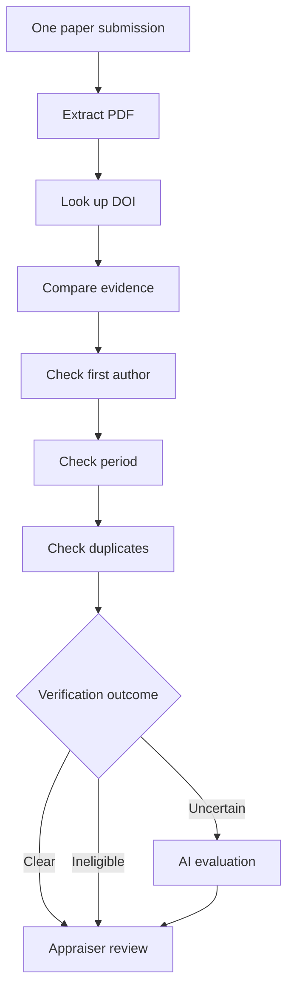

# Publication workflow walkthrough

## Policy scope

The Publication workflow checks a paper's DOI and Crossref record, compares PDF details with that record, checks whether the faculty member is the first author, checks the assessment period, and looks for duplicate candidates in local test/session records. It sends the findings to an appraiser. It does not check Scopus/Web of Science or award marks automatically.

This workflow supports many DOI-bearing papers with readable PDFs and Crossref records, but it cannot verify every paper. Missing DOI/metadata, scans, ambiguous author names, and conflicting evidence need human review. Crossref lookup is metadata lookup, not proof that a paper meets an institution's KPI.

## 1. Inputs

Open Inputs. On an empty form, use **Or try publication example inputs**, or create:

| Field | Type | Required | Configuration |
|---|---|---|---|
| Research paper | File upload | Yes | `.pdf`, one file |
| DOI | Short text | No | DOI or DOI text |
| Publication URL | URL | No | URL containing the DOI |
| Faculty name | Short text | Yes | Full name for matching |

Set the KPI name. Existing agreed fields can be reused; do not replace them unnecessarily.

## 2. Load and inspect the example

Open Workflow → Build workflow. On an empty canvas, click **Explore the publication example**. This inserts ten connected steps. One paper flows through them all as needed.

| Step | Required mapping/settings |
|---|---|
| Submit paper | Uses all form fields |
| Extract paper details | Research paper file |
| Look up publication | Extracted DOI; optional submitted DOI cross-check and URL |
| Compare evidence | Extracted paper + external publication record |
| Check first author | Faculty name + publication record |
| Check assessment dates | Publication record + configured dates/date rule |
| Check duplicates | Publication record + faculty name; optional seed records |
| Decide verification outcome | Comparison, author, dates, duplicate findings |
| AI evaluation | Decision output; instructions, mode, and optional schema |
| Appraiser review | Decision and optional AI details |

Use start `2021-01-01`, end `2021-12-31`, and Published date for the included sample. Keep the simulated registry entry for the first test. Use Simulated assistance for a deterministic offline AI rehearsal, or OpenRouter to generate actual advice.

The default routes are:

## 3. Scoring

The Publication workflow does not choose an institution's point values. Create or select the institution's scoring policy separately, then add an appropriate scoring step and map verified workflow findings to it. Do not use the former 24/12 mock-index example as an institutional rule. A reviewer can inspect the evidence package before marks are finalized.

## 4. Sample submission

Open Test & review, fix setup items, and click **Fill sample submission**.

| Value | Sample |
|---|---|
| Paper | Included PRISMA 2020 PDF |
| DOI | `10.1371/journal.pmed.1003583` |
| Faculty | `Matthew J. Page` |
| Published | 29 March 2021 |
| URL | `https://journals.plos.org/plosmedicine/article?id=10.1371/journal.pmed.1003583` |

The PDF is in `public/samples/prisma-2020-paper.pdf`; Download sample paper is also available in the test view. [Attribution](../public/samples/README.txt) is retained. A methodology guideline used as a fixture is not automatically eligible under a real institution's policy.

Run this submission. With consistent Crossref metadata and the configured period, the workflow should identify a first-author match and send the evidence to review. It does not recommend points. A network failure, mismatch, or ambiguous extraction can require review.

## 5. Review and edge cases

Enter an appraiser name, approve, and record the decision. The score and original recommendation remain visible. Overrides require a reason and non-negative points.

Without reloading, submit again: the same DOI/faculty pair should become a duplicate candidate. Change the period to 2022 to test ineligibility. A different first-author name should produce uncertainty. Duplicate detection is limited to seed records and approved records in this browser session; it is not an institution-wide database.

## Add a clear-path AI summary

Insert Action → AI evaluation on the Clear path. Name it Appraiser summary; map the verification decision object to its primary input. Suggested instructions:

> Summarize the evidence for the appraiser in five bullets. Include DOI/record consistency, first-author match, assessment eligibility, duplicate findings, and limitations. Do not invent missing facts.

Continue to Calculate marks or the next intended step. The existing Needs review AI can have different instructions. Inspect each executed AI response in the trace. A shared legacy review has one optional assistance mapping; it does not automatically merge responses from different branches.

## Publication plugin

To add the complete flow, click a workflow + → Plugin → **Publication workflow**. The builder inserts all ten connected steps at once, with publication operations represented as Publication plugin nodes. Suggested mappings use matching form fields and earlier outputs. AI evaluation remains a general Action. The decision step preserves Clear / Needs review / Ineligible routes. Scopus/Web of Science checks and automatic publication scoring are excluded; scoring rules remain institution-specific.

If the workflow already contains steps, the picker asks before replacing the chart. Confirm only when you want the complete Publication flow to replace it; Undo restores the previous chart. Existing saved operation nodes remain individually editable from their settings.
