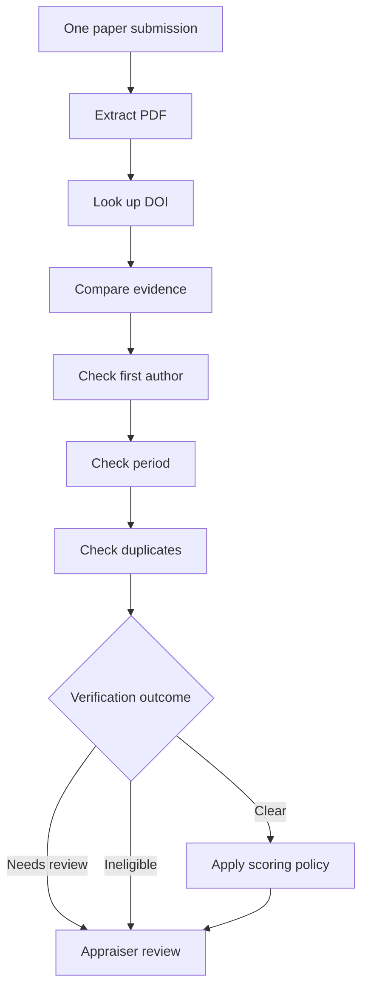

# Publication workflow walkthrough

## Policy scope

The Publication workflow checks a paper's DOI and Crossref record, compares PDF details with that record, checks first authorship and the assessment period, and looks for duplicate candidates in local test/session records. A clear result goes through the selected saved scoring policy; clear, needs-review, and ineligible paths all converge on the same appraiser review node. Needs-review and ineligible paths skip scoring. The workflow does not check Scopus/Web of Science.

This workflow supports many DOI-bearing papers with readable PDFs and Crossref records, but it cannot verify every paper. Missing DOI/metadata, scans, ambiguous author names, and conflicting evidence need human review. Crossref lookup is metadata lookup, not proof that a paper meets an institution's KPI.

## 1. Inputs

Open Inputs. On an empty form, use **Or try publication example inputs**, or create:

| Field | Type | Required | Configuration |
|---|---|---|---|
| Research paper | File upload | Yes | `.pdf`, one file |
| DOI | Short text | No | DOI or DOI text |
| Publication URL | URL | No | URL containing the DOI |
| Faculty name | Short text | Yes | Full name for matching |

Set the KPI name. Existing agreed fields can be reused; do not replace them unnecessarily.

## 2. Load and inspect the example

Open Workflow → Build workflow. On an empty canvas, click **Explore the publication example**. This inserts ten connected steps. One paper flows through them all as needed.

| Step | Required mapping/settings |
|---|---|
| Submit paper | Uses all form fields |
| Extract paper details | Research paper file |
| Look up publication | Extracted DOI; optional submitted DOI cross-check and URL |
| Compare evidence | Extracted paper + external publication record |
| Check first author | Faculty name + publication record |
| Check assessment dates | Publication record + configured dates/date rule |
| Check duplicates | Publication record + faculty name; optional seed records |
| Decide verification outcome | Comparison, author, dates, duplicate findings |
| Apply scoring policy | Clear decision path only; selected saved policy version |
| Appraiser review | Decision and optional score; all three decision paths converge here |

Use start `2021-01-01`, end `2021-12-31`, and Published date for the included sample. Save a conditional scoring policy with the institution's approved rules. If a saved version is selected, the template preselects it; otherwise, choose a version in the Apply scoring policy step before running.

The default routes are:

## 3. Scoring

The Publication workflow does not choose an institution's point values. Save an institution-approved conditional scoring policy, then select it in the Apply scoring policy step. That step runs only on the Clear branch and passes the provisional score to Appraiser review. Needs-review and ineligible findings bypass scoring but still reach the same review node. A missing or unmatched rule remains pending; do not use the former 24/12 mock-index example as an institutional rule.

## 4. Sample submission

Open Test & review, fix setup items, and click **Fill sample submission**.

| Value | Sample |
|---|---|
| Paper | Included PRISMA 2020 PDF |
| DOI | `10.1371/journal.pmed.1003583` |
| Faculty | `Matthew J. Page` |
| Published | 29 March 2021 |
| URL | `https://journals.plos.org/plosmedicine/article?id=10.1371/journal.pmed.1003583` |

The PDF is in `public/samples/prisma-2020-paper.pdf`; Download sample paper is also available in the test view. [Attribution](../public/samples/README.txt) is retained. A methodology guideline used as a fixture is not automatically eligible under a real institution's policy.

Run this submission. With consistent Crossref metadata, first-author match and an eligible date, the Clear path applies the selected scoring policy before Appraiser review. If there is no selected policy or no rule matches, scoring remains pending. A network failure, mismatch or ambiguous extraction follows Needs review directly to Appraiser review.

## 5. Review and edge cases

Enter an appraiser name, approve, and record the decision. The score and original recommendation remain visible. Overrides require a reason and non-negative points.

Without reloading, submit again: the same DOI/faculty pair should become a duplicate candidate. Change the period to 2022 to test ineligibility. A different first-author name should produce uncertainty. Duplicate detection is limited to seed records and approved records in this browser session; it is not an institution-wide database.

## Publication plugin

To add the complete flow, click a workflow + → Plugin → **Publication workflow**. The builder inserts ten connected steps at once, including the generic Apply scoring policy Action. Clear goes through scoring; Needs review and Ineligible bypass scoring; all paths reach Appraiser review. AI evaluation is not part of this plugin template. Scopus/Web of Science checks remain excluded, and institutions supply their own saved scoring rules.

If the workflow already contains steps, the picker asks before replacing the chart. Confirm only when you want the complete Publication flow to replace it; Undo restores the previous chart. Existing saved operation nodes remain individually editable from their settings.
