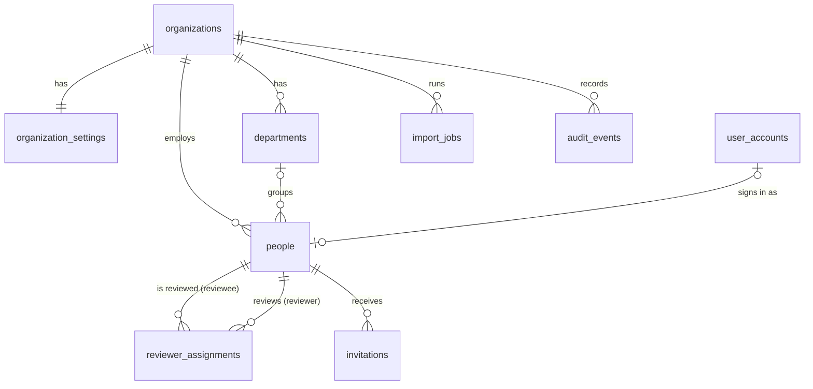

# Organization — Database schema and ER diagram

**Current implementation:** none. The UI prototype keeps sample data in the browser tab (`apps/web/lib/setup-store.tsx`). Nothing here exists in a database yet.

**Proposed design:** the tables below, in PostgreSQL, following the [data architecture decision](../../project/DATA-ARCHITECTURE.md). Column lists show the important fields, not every column. Every table also has `created_at` and `updated_at` (UTC). Primary keys are UUID v7.

**Known limitations:** this is a first-release design for one institution. Row-level security, data retention and cross-organization isolation are not designed yet.

## Ownership

| Table | Owner module | Notes |
|---|---|---|
| `user_accounts` | Identity | Login identity. Shown here only because people link to it. |
| `organizations`, `organization_settings`, `departments`, `people`, `reviewer_assignments`, `invitations`, `import_jobs` | Organization | Written only by the Organization module. |
| `audit_events` | Shared, written by every module | Append-only. |

## ER diagram

## Tables

### `organizations`

| Column | Type | Notes |
|---|---|---|
| `id` | uuid | |
| `name` | text | Required |
| `type` | text | One of the prototype's types, for example `Educational institution` or `Manufacturing` |
| `size_band` | text | One of the prototype's bands, for example `51 to 200` |
| `country`, `city` | text | |
| `website`, `contact_email`, `phone` | text | Optional |
| `setup_completed_at` | timestamptz | Null until invitations are first sent |

### `organization_settings`

One row per organization. Stable settings are columns; rarely used options sit in `extra jsonb`.

| Column | Type | Notes |
|---|---|---|
| `organization_id` | uuid | Primary key and foreign key |
| `time_zone` | text | IANA name, for example `Asia/Kolkata` |
| `year_start_month` | smallint | 1 to 12 |
| `date_format` | text | `DD/MM/YYYY`, `MM/DD/YYYY` or `YYYY-MM-DD` |
| `week_start` | text | `monday`, `sunday` or `saturday` |
| `language` | text | |
| `working_days` | smallint[] | 0 = Sunday … 6 = Saturday |
| `invite_expiry_days` | int | |
| `invite_sender_name`, `invite_reply_to` | text | |
| `invite_reminders` | text | `off`, `every3` or `weekly` |
| `sign_in_method` | text | `password`, `sso` or `both` |
| `allowed_email_domains` | text[] | |
| `session_minutes` | int | |
| `two_step_required` | boolean | |
| `evidence_types` | text[] | Allowed file types |
| `evidence_max_mb` | int | |
| `retention_years` | smallint | 0 = keep until deleted |
| `extra` | jsonb | New, rarely used options, validated by the API |

### `departments`

| Column | Type | Notes |
|---|---|---|
| `id`, `organization_id` | uuid | |
| `name` | text | Unique per organization |
| `code` | text | Optional short code, unique per organization |
| `color` | text | One of the UI palette keys |
| `sort_order` | int | Order in lists |
| `archived_at` | timestamptz | Departments are archived, not deleted |

### `people`

A person in the organization. They may not have signed in yet.

| Column | Type | Notes |
|---|---|---|
| `id`, `organization_id` | uuid | |
| `user_account_id` | uuid | Null until the invitation is accepted |
| `full_name` | text | |
| `email` | citext | Unique per organization |
| `job_title` | text | |
| `department_id` | uuid | Nullable |
| `is_reviewer` | boolean | Can review others |
| `is_admin` | boolean | Organization administrator |
| `status` | text | `invited`, `active` or `deactivated` |
| `deactivated_at` | timestamptz | No hard deletes |

### `reviewer_assignments`

Who reviews whom. Kept as history rather than a single column so changes stay auditable and can later be scoped to an appraisal cycle.

| Column | Type | Notes |
|---|---|---|
| `id`, `organization_id` | uuid | |
| `reviewee_id` | uuid | Person being reviewed |
| `reviewer_id` | uuid | Must have `is_reviewer = true` and differ from `reviewee_id` |
| `effective_from` | timestamptz | |
| `effective_to` | timestamptz | Null for the current assignment |

Rule: at most one current assignment per reviewee (partial unique index on `reviewee_id` where `effective_to` is null).

### `invitations`

| Column | Type | Notes |
|---|---|---|
| `id`, `organization_id`, `person_id` | uuid | |
| `token_hash` | text | Only a hash of the link token is stored |
| `status` | text | `pending`, `sent`, `accepted`, `expired`, `failed`, `revoked` |
| `sent_at`, `expires_at`, `accepted_at` | timestamptz | |
| `send_count` | int | Increases on resend |
| `last_error` | text | Delivery failure reason, if any |

### `import_jobs`

CSV imports run as jobs so large files do not block a request.

| Column | Type | Notes |
|---|---|---|
| `id`, `organization_id` | uuid | |
| `file_key` | text | Object-storage key of the uploaded CSV |
| `department_id` | uuid | Optional default department |
| `status` | text | `queued`, `validating`, `ready`, `applied`, `failed` |
| `summary` | jsonb | Counts and per-row errors |
| `created_by` | uuid | Person who started it |

### `audit_events` (shared)

| Column | Type | Notes |
|---|---|---|
| `id`, `organization_id` | uuid | |
| `actor_id` | uuid | Person or system |
| `action` | text | For example `person.deactivated`, `reviewer.changed` |
| `entity_type`, `entity_id` | text, uuid | |
| `before`, `after` | jsonb | Changed fields only |
| `occurred_at` | timestamptz | |

## How the prototype maps to this

| Prototype (`setup-store.tsx`) | Table |
|---|---|
| `organization` | `organizations` |
| `config` | `organization_settings` |
| `departments` | `departments` |
| `employees` (with `isReviewer`) | `people` |
| `employee.reviewerId` | current row in `reviewer_assignments` |
| `invitesSent` | `invitations` rows and `organizations.setup_completed_at` |
