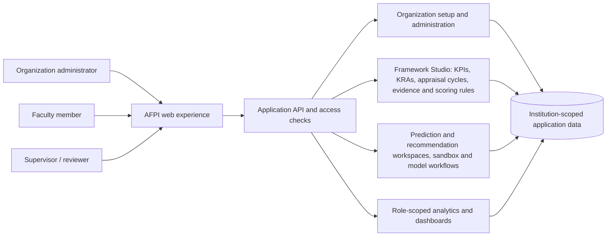

# AFPI — Proposed production architecture

## Status and scope

**Status:** Proposed product architecture based on the agreed release direction. This document describes logical responsibilities and flows; it does not claim that the production system exists or select a technology stack, database, deployment topology, or API protocol.

The production-oriented product is to be designed anew. The existing proof of concept is historical reference and is not the production architecture.

## Product direction

- The first release must provide the complete core appraisal and analytics workflow for organization administrators, faculty members, and supervisors/reviewers.
- The first release is intended for one institution. Multi-organization access is a possible later product evolution, not a first-release requirement.
- The design should keep institution-owned configuration and data clearly bounded so future multi-tenancy can be evaluated without claiming that tenant isolation is already implemented.
- The product is analytics-oriented: it combines configurable KPIs/KRAs, evidence review, released marks, prediction/recommendation capabilities, and role-appropriate analytics.

## Proposed capability boundaries

The boxes show logical responsibilities, not separate deployable services. The API and deployment structure remain open decisions. Model training may need a separate worker or service if its runtime and scaling needs justify it; that boundary is not selected here.

### Organization administration

Organization administrators configure and facilitate the institution's appraisal process. Their first-release needs include creating KPIs and KRAs, configuring appraisal cycles and assignments, providing faculty with the required submission process, configuring prediction and recommendation capabilities, and viewing institution-level analytics. They establish the operating environment; supervisors perform the operational review and release KPI marks.

### Appraisal framework and review operations

Framework Studio owns the configurable appraisal concepts: KPIs, KRAs, cycles, evidence requirements, and approved scoring rules. Its supervisor-review capability handles submitted evidence, reviewer decisions, and the supervisor's release of marks for each KPI. Review is a capability within Framework Studio, not a fifth top-level module. The exact policy formula, review states, override rules, and audit events require institutional decisions and are not specified by this proposal.

### Prediction, recommendation, and analytics

Organization administrators need model-building, training, and evaluation workspaces, including sandboxes for prediction and recommendation models. Faculty-facing outputs and their release rules must be defined by institutional policy. Analytics should support administrator views across the institution, including KPI/KRA and faculty performance/level analytics, and supervisor views limited to authorized faculty; faculty members see their own authorized results. Specific measures, level definitions, and model governance remain to be agreed.

## Proposed end-to-end flow

1. An organization administrator sets up the appraisal structure, KPIs/KRAs, cycles, assignments, and evidence requirements.
2. Faculty members complete assigned KPIs, submit information and evidence, and track review progress.
3. A supervisor reviews submissions for assigned faculty, records the KPI mark and decision through Framework Studio, and releases the mark to the faculty member.
4. The application updates the authorized dashboards: institution-wide for administrators, scoped team analytics for supervisors, and personal results for faculty.
5. Administrators build, train, and evaluate prediction/recommendation models in their workspaces and sandbox. The rules for training data, approval, publication, and employee visibility must be decided before implementation.

This flow is product direction, not a verified implementation or final state machine.

## Data and access principles

- Treat the institution as an explicit boundary for configuration, appraisal data, model assets, and analytics.
- Resolve a user's role and permitted scope before returning sensitive data. A role label alone is not sufficient to grant access to every faculty record.
- Scope supervisor review and analytics to assigned faculty; scope faculty results to the individual; grant administrators only the institution-level access their approved duties require.
- Keep consequential evidence, review decisions, released marks, and model outputs traceable to their relevant source and version.
- Do not infer or publish scores, model outputs, or review decisions as final before the authorized human action and applicable institutional rules are satisfied.
- Future multi-tenant support will require explicit isolation design and verification. This proposal does not define or claim that enforcement.

## Current implementation

The repository now contains the structural foundation merged through PR #53: a clean Next.js workspace, a NestJS modular API scaffold, reserved Python model-training and shared-contract locations, and a preserved PoC archive. These are structural foundations only: no product workflow described above has been verified as implemented. See [repository structure](REPOSITORY-STRUCTURE.md) for the path-by-path status and the [legacy archive](../reference/legacy/README.md) for historical material.

## Known limitations and decisions still open

- Final release scope at the feature and policy level, including detailed administrator responsibilities.
- Authentication, role/permission model, organization context, and future multi-tenant isolation strategy.
- Approved KPI/KRA definitions, scoring formula, reviewer states, mark changes, and release/audit policy.
- Data ownership, database schema, evidence storage, retention, privacy, and reporting definitions.
- API contracts and whether the API, model training, and other capabilities share a deployment or run independently.
- Model lifecycle, authorized training data, evaluation criteria, approvals, publication, monitoring, and faculty-facing visibility.
- Deployment, operations, availability, backups, observability, and security requirements.

Until these decisions are recorded and verified, this document is a proposed logical architecture only.
