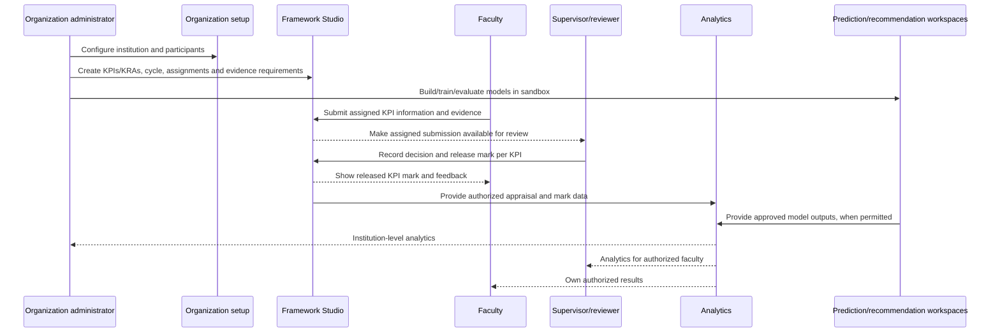

# Cross-module integration contracts

## Status

**Proposed logical flow only.** No production API contract, event schema, persistence behavior, or service-to-service protocol has been approved or verified. This page records the responsibilities that future contracts must support; it does not define endpoint names or claim they exist.

## First-release role flow

The sequence is conceptual. It does not settle whether modules communicate through in-process calls, HTTP APIs, events, or background jobs.

## Logical ownership

| Capability | Owns | Integrates with |
|---|---|---|
| Organization | Institution setup, membership, assignments, and administrative context | Framework configuration, access decisions, institution dashboards |
| Framework Studio | KPI/KRA definitions, appraisal cycles, evidence requirements, approved scoring configuration, supervisor review, feedback, and per-KPI mark release | Faculty submissions and analytics |
| Prediction | Prediction model workspace, sandbox/evaluation flow, and approved prediction outputs | Authorized institution data and analytics; faculty visibility remains policy-controlled |
| Recommendation | Recommendation model/workflow configuration, sandbox/evaluation, and approved outputs | Authorized institution data and analytics; faculty visibility remains policy-controlled |
| Analytics | Role-appropriate views and metrics derived from approved source data | Organization, framework/review, prediction, and recommendation data |

These are proposed logical boundaries, not a decision that each capability is a separately deployed service. Supervisor review is a capability within Framework Studio, not a fifth top-level module. Analytics may be a shared application capability rather than an independently owned module; the final boundary is open.

## Contract requirements to resolve

- Authoritative user, institution, and reviewer-assignment context for each operation.
- KPI/KRA, appraisal-cycle, assignment, submission, evidence, review, and released-mark identifiers and versioning.
- Approved mark calculation and release semantics, including returned submissions, corrections, overrides, and audit history.
- Model training/evaluation jobs, dataset permissions, model/version identifiers, approval, publication, and failure reporting.
- Dashboard metric definitions, freshness, provenance, and role-based visibility.
- Request/response or event schemas, idempotency, retries, asynchronous job status, and error conventions.
- Data retention, evidence-file handling, and cross-institution isolation requirements before multi-organization support.

## Current implementation and limitations

The repository's proof-of-concept routes and modules are historical reference, not approved production contracts. No production integration contract is verified. See [proposed architecture](ARCHITECTURE.md) and [decision log](DECISIONS.md).
