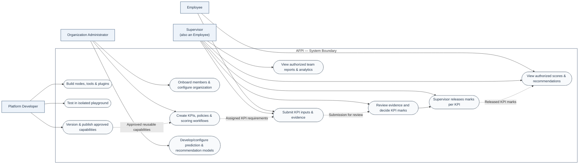

# AFPI — Project overview

**Adaptive Faculty Performance Intelligence (AFPI)** is being redesigned as a **production-oriented, modular faculty appraisal and analytics product**, with a longer-term SaaS direction. The first release is intended to deliver the complete core workflow for organization administrators, faculty members, and supervisors/reviewers at one institution. The product may later evolve to serve multiple organizations; that is not a first-release requirement. Existing PoC code and documents remain historical reference only; the new architecture and module designs must be defined and verified independently.

## Actors and responsibilities

In software engineering, an **actor** represents a role interacting with a system (as in a UML use-case model). The platform currently recognizes three primary actor groups, with **Employee** specialized into two responsibilities:

| Actor | Responsibilities |
|---|---|
| **Organization Administrator** | Set up and facilitate the institution's appraisal process; manage people and assignments; create KPIs/KRAs and appraisal cycles; build, train, and evaluate prediction and recommendation models in sandboxes; view institution-level KPI, KRA, and faculty performance/level analytics. Administrators do not release KPI marks in the described workflow. |
| **Faculty member** | Complete assigned KPIs, submit information and evidence, track review progress, and view their own marks after a supervisor releases them, plus other authorized results. |
| **Supervisor / reviewer** | Perform their own faculty-member tasks where applicable; review assigned faculty submissions, decide and release marks for each KPI, provide feedback, and inspect analytics for faculty within their authorized scope. |
| **Platform Developer** | Create reusable nodes, tools and plugins; test and debug them in an isolated playground; version and publish approved capabilities; maintain AFPI software and supporting infrastructure |

**Actor relationships:** A Supervisor may also be a faculty member and retain their own faculty workflow, while receiving additional, scope-limited review and analytics capabilities. The organization administrator configures and facilitates the process; supervisors perform reviews and release per-KPI marks. These are product responsibilities, **not a deployed RBAC contract**. Exact permissions and access scopes remain to be designed. The first-release direction is one institution; multi-organization isolation is a later design concern.

### Use-case interaction overview

The following **Mermaid use-case-style diagram** illustrates major actors and interactions. It is intentionally a conceptual interaction map rather than a formal UML notation or an assertion that these capabilities have shipped.

**Interpretation:** Organization administrators configure and facilitate the evaluation system; faculty supply evidence and view their own released outcomes; supervisors review assigned faculty, release marks for each KPI, and use scoped analytics. The first release is expected to cover this complete core workflow plus administrator KPI/KRA setup, model workspaces/sandbox, and institution analytics. This is product direction, not a claim that any capability has shipped. Detailed navigation, policy rules, and screens remain to be designed.

## Modules
- **Framework Studio:** configurable KPI/KRA and appraisal-cycle setup, faculty evidence submissions, supervisor review, and per-KPI mark release.
- **Prediction:** administrator model-building/evaluation workspace and sandbox, with role-appropriate prediction outputs and analytics to be defined.
- **Recommendation:** administrator recommendation-building/evaluation workspace and sandbox, with role-appropriate outputs and analytics to be defined.
- **Organization:** institution setup, membership and assignments, and the administrative workspace that facilitates the appraisal process.

These four are the currently identified modules, not a permanent limit on platform extensibility. Their boundaries are logical capabilities; this does not determine whether they deploy together or separately. The first-release target is one institution, with future multi-organization support considered in the design. The new implementation's design and readiness status should be recorded in each module README. The older browser PoC is not evidence that the replacement is implemented.

## Documentation
- [Shared architecture](ARCHITECTURE.md)
- [Engineering design principles](DESIGN-PRINCIPLES.md)
- [Shared UI/UX specification — Topics 01–04](UI-UX.md)
- [Shared schema and ER diagram](DATABASE-SCHEMA.md)
- [Module integrations](INTEGRATION.md)
- [Cross-module testing](TESTING.md)
- [Roadmap](ROADMAP.md)
- [Project decisions](DECISIONS.md)
- [Project-wide audit register](audits/README.md)
- [Module documentation](../modules/)
- [Historical PoC archive](../reference/legacy/README.md)

**Accuracy rule:** Distinguish current production-oriented implementation, proposed architecture, and known limitations. Blank technical documents are intentional until there are verified decisions or evidence.
