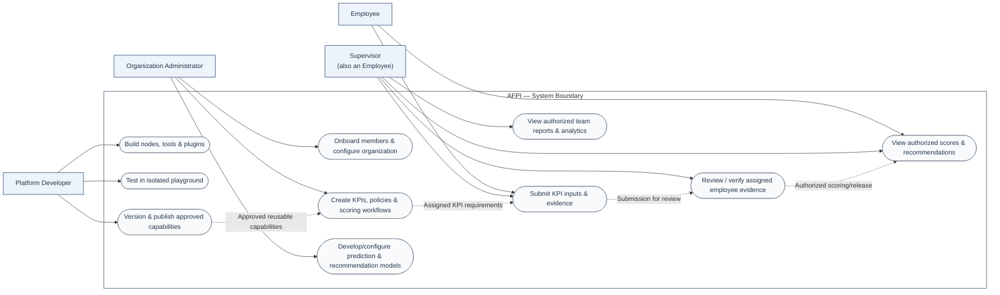

# AFPI — Project overview

**Adaptive Faculty Performance Intelligence (AFPI)** is being redesigned as a **production-oriented, modular faculty appraisal and decision-support system**. Existing PoC code and documents remain historical reference only; the new architecture and module designs must be defined and verified independently.

## Actors and responsibilities

In software engineering, an **actor** represents a role interacting with a system (as in a UML use-case model). The platform currently recognizes three primary actor groups, with **Employee** specialized into two responsibilities:

| Actor | Responsibilities |
|---|---|
| **Organization Administrator** | Onboard/manage employees; define regulations, policies, KPIs, verification and scoring frameworks; configure organization-specific server/workspace settings; develop/configure institution-specific prediction and recommendation models; govern publication and approval |
| **Employee (individual contributor)** | Complete assigned KPIs, submit supporting evidence for verification, track review progress, and view their own authorized scores, predictions and recommendations |
| **Supervisor (Employee specialization)** | Perform their own Employee tasks **and** verify/review assigned employees' KPI evidence, handle feedback and inspect authorized team reports/analytics |
| **Platform Developer** | Create reusable nodes, tools and plugins; test and debug them in an isolated playground; version and publish approved capabilities; maintain AFPI software and supporting infrastructure |

**Actor relationships:** A Supervisor is an Employee with additional, scope-limited review and analytics capabilities—not a separate tenant type. An Organization Administrator has organizational governance powers, whereas a Platform Developer builds AFPI itself; neither role automatically receives unrestricted access to employee records. These are conceptual responsibilities, **not a deployed RBAC contract**. Access scope, approvals and tenant isolation must be designed under [Issue #44](https://github.com/Kaushiik-13/KCT_AppraisalPortal/issues/44).

### Use-case interaction overview

The following **Mermaid use-case-style diagram** illustrates major actors and interactions. It is intentionally a conceptual interaction map rather than a formal UML notation or an assertion that these capabilities have shipped.

**Interpretation:** Organizations create and govern the evaluation system; Employees supply evidence and view permitted outcomes; Supervisors review their assigned employees while also using the Employee experience; Developers supply tested platform capabilities without default access to institutional data. The detailed navigation structure and individual screens will be decided during feature implementation.

## Modules
- **Framework Studio:** production-oriented redesign of configurable KPI inputs, evidence verification and scoring workflows.
- **Prediction:** production-oriented redesign of performance prediction and evaluation workflows.
- **Recommendation:** new module; architecture and implementation not yet defined.
- **Organization:** new module; architecture and implementation not yet defined.

These four are the currently identified modules, not a permanent limit on platform extensibility. The new implementation's design and readiness status should be recorded in each module README. The older browser PoC is not evidence that the replacement is implemented.

## Documentation
- [Shared architecture](ARCHITECTURE.md)
- [Engineering design principles](DESIGN-PRINCIPLES.md)
- [Shared UI/UX specification — Topics 01–04](UI-UX.md)
- [Shared schema and ER diagram](DATABASE-SCHEMA.md)
- [Module integrations](INTEGRATION.md)
- [Cross-module testing](TESTING.md)
- [Roadmap](ROADMAP.md)
- [Project decisions](DECISIONS.md)
- [Project-wide audit register](audits/README.md)
- [Module documentation](../modules/)
- [Historical PoC archive](../reference/legacy/README.md)

**Accuracy rule:** Distinguish current production-oriented implementation, proposed architecture, and known limitations. Blank technical documents are intentional until there are verified decisions or evidence.
